> Estimated Time: 2 hours


````{r setup, include=FALSE}
knitr::opts_chunk$set(python.reticulate = FALSE)
````


**Course participants**: As you review this information, please
consider the final course project
that you will  build upon over this semester. At the end of this section, you will
document an initial research question or idea and associated data needed to
address that question, that you may want to explore while pursuing this course.


## GEE Learning Objectives

At the end of this activity, you will be able to:

* Understand the structure and capabilities of Google Earth Engine (GEE), including its cloud-based infrastructure, data catalog, and computational resources

* Access data and apply fundamental processing techniques using the GEE Code Editor and JavaScript API

* Utilize alternative programming interfaces (APIs), including the Python API and R interface (rgee)

* Integrate Earth Engine into broader ecoinformatics workflows by accessing, processing, and analyzing cloud-hosted geospatial data within external computational environments


## GEE Overview:

<iframe width="560" height="315" src="https://www.youtube.com/embed/gKGOeTFHnKY?si=V4ZwjGtbd8B_76cD" frameborder="0" allow="accelerometer; autoplay; encrypted-media; gyroscope; picture-in-picture" allowfullscreen></iframe>

The [Google Earth Engine (GEE)](https://earthengine.google.com/) platform combines a multi-petabyte catalog of satellite imagery and geospatial datasets with the massive computational power of Google's cloud infrastructure. Rather than downloading and processing large datasets locally, GEE users can leverage Google's distributed computing resources to perform complex analyses across large spatial and temporal scales. This architecture enables planetary-scale environmental monitoring and analysis that would otherwise require substantial local computing resources and data storage. 

Scientists, researchers, and developers use Earth Engine to detect environmental changes, identify trends, and quantify processes occurring across the Earth's surface. Students and academic researchers can access Earth Engine at no cost for eligible noncommercial educational and research activities. Commercial use is also supported through separate pricing arrangements.

## Learning Materials
Since its initial launch in 2010, Google Earth Engine has grown into one of the most widely used platforms in the remote sensing and geospatial research communities. Its capabilities and large international user base have generated a wealth of learning materials, including official documentation, tutorials, video lectures, textbooks, workshops, and community-developed tools and workflows. Students are encouraged to take advantage of these resources and explore the various ways that GEE can be applied to research tasks in their area of interest. 

### Lecture: Google Earth Engine 101 

<iframe width="560" height="315" src="https://www.youtube.com/embed/I-wFYm4Hnhg" title="Google Earth Engine 101 Part 1" frameborder="0" allow="accelerometer; autoplay; encrypted-media; gyroscope; picture-in-picture" allowfullscreen></iframe>

> Time: 1 hour, 17 minutes

### Recommended Resources
For students interested in developing a deeper understanding of GEE, the open textbook [Cloud-Based Remote Sensing with Google Earth Engine: Fundamentals and Applications](https://www.eefabook.org/) is an exceptional supplementary resource. Edited by over 100 researchers, practitioners, and Earth Engine experts (notably several Google engineers and developers directly involved in building the platform), this textbook is among the most comprehensive resources available for learning Earth Engine. It is highly recommended as a reference throughout this course and beyond. 

```{r, echo=FALSE}
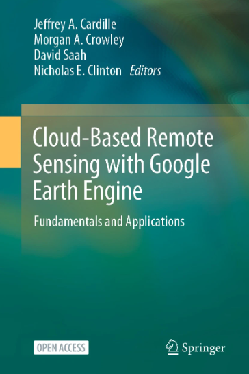
```


### Relevant Links:

1. [GEE platform overview](https://earthengine.google.com/platform/)

2. [GEE documentation](https://developers.google.com/earth-engine/)

3. [GEE datasets](https://developers.google.com/earth-engine/datasets/)

4. [Case studies](https://earthengine.google.com/case_studies/)
5. [Tutorials](https://developers.google.com/earth-engine/tutorials)
6. [Machine learning in GEE](https://developers.google.com/earth-engine/guides/machine-learning)


## [Data Available on GEE](https://developers.google.com/earth-engine/datasets):
```{r, echo=FALSE}
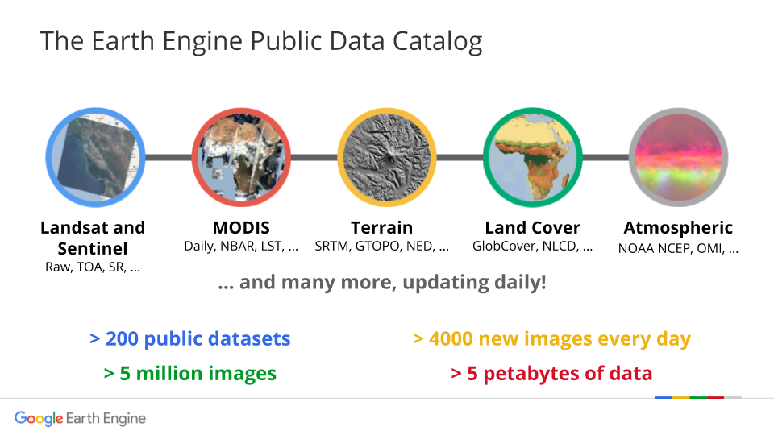
```

* Basic

  * Elevation & Topography
  * Imagery - Orthophotos (Aerial)
  * Imagery - Satellite
  * Land Use & Land Cover

* Geography

  * Atmosphere
  * Atmospheric Water Vapor
  * Climate
  * Cryosphere
  * Fire
  * Oceans
  * Precipitation
  * Soil
  * Surface and Ground Water
  
* Biosphere
  
  * Ecosystems
  * Forest & Biomass
  * Plant Productivity
  * Vegetation Indices
  
* Human Dimensions
  
  * Agriculture
  * Infrastructure & Boundaries
  * Population


## Hands on: Using the GEE Code Editor

GEE makes their data available through a number of different [channels and tools](https://developers.google.com/earth-engine). This flexibility reflects the way geospatial data are handled in Earth Engine: rather than downloading datasets locally, users send computational requests to remote servers where the data are stored and processed. These requests are made through a set of APIs and client libraries that translate user-written code into Earth Engine operations.

Access to Earth Engine data is typically mediated through these client libraries, which provide interfaces in both JavaScript and Python. These libraries act as a bridge between user-written code and the Earth Engine servers, allowing complex geospatial analyses to be expressed in a relatively compact and high-level syntax. Users can also interact directly with Earth Engine through a REST API, although this is less commonly used for exploratory analysis.

One of the most widely used interfaces is the JavaScript-based [Code Editor](https://developers.google.com/earth-engine/guides/playground), which provides an interactive, browser-based environment for working with Earth Engine data. The Python client library offers similar functionality, and can be used in environments such as Google Colab, local Python installations, or cloud-based platforms such as App Engine. Together, these interfaces allow users to choose a workflow that best fits their computational background and research needs.

### Setting Up an Earth Engine Account

Before accessing any of the interfaces described above, a Google Earth Engine account is required. As of 2024, registration is no longer a standalone process. Earth Engine access is granted at the level of a **Google Cloud project**, which is linked to your Google account. This change was made to support the platform's commercial release while preserving free access for academic and research users.

To register:

1. Sign in at <https://code.earthengine.google.com/register> with the Google account you intend to use for Earth Engine (e.g., @nau.edu email).
2. Choose the **noncommercial/academic** use option when prompted.
3. Either select an existing Google Cloud project or create a new one. Most new users will create a project at this stage; the project name (e.g., `ee-yourusername`) which you will later pass to `ee.Initialize()` or `ee_Initialize()` from  the Python and R client libraries.
4. Confirm registration. Approval is typically immediate for noncommercial use.

**A note on quotas:** in 2026, Earth Engine introduced a tiered quota system for noncommercial projects. Projects that have not selected a tier are placed in the *Community Tier* by default, which is sufficient for coursework and exploratory analysis but applies stricter rate limits than higher tiers. If you find that long-running scripts begin to fail with `OverQuotaError`, the quota tier of your project is the first thing to check. Tier selection is done from the Earth Engine project management page at <https://code.earthengine.google.com/register>.

Once registered, the Code Editor at <https://code.earthengine.google.com/> is immediately accessible. No further authentication is required from the browser. The Python and R client libraries each require an additional local authentication step, which is described in the *Other Interfaces* section later in this chapter.


### The GEE Code Editor 

GEE provides access to a Code Editor as an integrated development environment (IDE) for the Earth Engine JavaScript API. This IDE offers a platform to write and execute code, visualize results on an interactive map, and manage scripts and projects within a single web-based environment. The Code Editor is accessed through a dedicated webpage:

https://code.earthengine.google.com/

Access to Earth Engine data through the Code Editor is built around the JavaScript programming language, which serves as the primary scripting interface for this environment. JavaScript provides a lightweight and accessible syntax that acts as a direct bridge to the Earth Engine API, where all geospatial computations are performed. Although JavaScript may not be the most familiar programming language for many researchers in the geosciences, it is the most mature and fully supported option within Earth Engine. Importantly, users do not need to become expert JavaScript programmers to use the platform effectively. Instead, a basic understanding of syntax is sufficient, since most operations in Earth Engine are performed by calling pre-built functions from the Earth Engine library. This [brief introduction](https://developers.google.com/earth-engine/tutorials/tutorial_js_01) to JavaScript syntax for GEE provided by the GEE developer team is enough to get started for most use cases.

When first accessing the Code Editor, you may be prompted to create a *home folder*. This folder is permanently linked to your Earth Engine account and serves as your personal workspace within the platform. It is good practice to choose a name that clearly identifies you, since this will be visible within shared Earth Engine environments and collaborative workflows.

Within your home folder, you can organize and store **scripts** and **repositories**, which function similarly to projects and code files in other development environments.

The Code Editor interface is divided into four main panels:

- **Script Manager (left panel):** Organizes your saved scripts and repositories
- **Script Editor (center panel):** Where you write and edit JavaScript code
- **Console (top-right panel):** Displays printed outputs, errors, and logs
- **Map Display (bottom panel):** Visualizes geospatial data and analysis results

```{r, echo=FALSE}
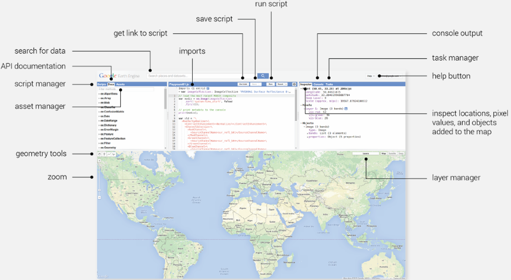
```
When learning a new programming environment, it is traditional to begin with a simple output such as “Hello World!”. In Earth Engine, we can adapt this to “Hello Earth!” to verify that the Code Editor is working and to become familiar with running scripts and viewing console output.

To do this, enter the following code in the Script Editor and execute the script by clicking **Run** at the top of the panel, or by pressing **Ctrl + Enter**:

```{js, eval=FALSE}
print('Hello Earth!');
```

You should see the text output appear in the upper-right panel under “Console”. This is basic JavaScript, which runs in your web browser on the client side. The power of GEE is in taking advantage of Google's vast infrastructure of servers to both access data and perform calculations on the server side. This client-server distinction is important in GEE and can be read about [here](https://developers.google.com/earth-engine/guides/client_server). We can now begin using GEE to access data on the server side, specifically, images and image collections.

### Working with Earth Engine Image Objects 
Before writing any code, it is useful to understand that the Earth Engine API's functionality is organized around **objects** (e.g., Earth Engine images, image collections, features, and feature collections) and associated **methods**, which are built-in functions that operate on these object types. Detailed documentation for these object types and their methods is provided in the 'Docs' panel on the upper left of the Code Editor. (See here for [more information on GEE objects and methods](https://developers.google.com/earth-engine/guides/objects_methods_overview)). 

Let's now begin working with GEE objects by accessing an image from Landsat 8, one of the most widely used Earth Observation platforms. In the Script Editor, enter and run the following code: 

```{js, eval=FALSE}
var firstImage = ee.Image("LANDSAT/LC08/C02/T1_L2/LC08_037035_20250619");
```

Notice the syntax. A new variable is declared using `var`, and each statement is terminated with a semicolon (`;`). Up to this point, this follows basic JavaScript conventions. Next, we assign the variable a GEE Image object using `ee.Image()`, passing the satellite image ID as an argument. Once the variable is created, we can add it to the map using `Map.addLayer()`.

```{js, eval=FALSE}
Map.addLayer(firstImage);
```
Notice that `Map` is another GEE object type, and methods such as `.addLayer()` provide means to interact with the Map Display of the Code Editor. 

The image should appear in your Map Display, however, we still need to adjust the image **visualization parameters** to make it visualize nicely. In this case, we can visualize the image using true color by entering the following parameters at the beginning of the script:
```{js, eval=FALSE}
var trueColorVis = {              // a dictionary object 
  bands: ["SR_B4","SR_B3","SR_B2"], // Use the Red, Green, Blue bands
  min: 8000, // minimum pixel value range
  max: 18000}; // maximum pixel value range 
```

Then modify the `Map.addLayer()` statement to include the visualization parameters and a title for the image. The argument order is: (image object, visualization parameters, layer title). 
```{js, eval=FALSE}
Map.addLayer(firstImage, trueColorVis, "First Image");
```

You should now be able to see your first satellite image, visualized over Flagstaff, Arizona and the Grand Canyon. 

```{r, echo=FALSE}
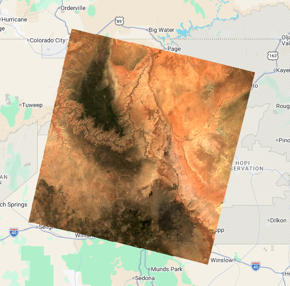
```

With an image now loaded into the GEE development environment, we can inspect it in various ways. In the upper-right panel, click the *Inspector* tab. Then with your cursor, click on a pixel of the satellite image on the Map Display. You will see some information populate the Inspector panel. 

```{r, echo=FALSE}
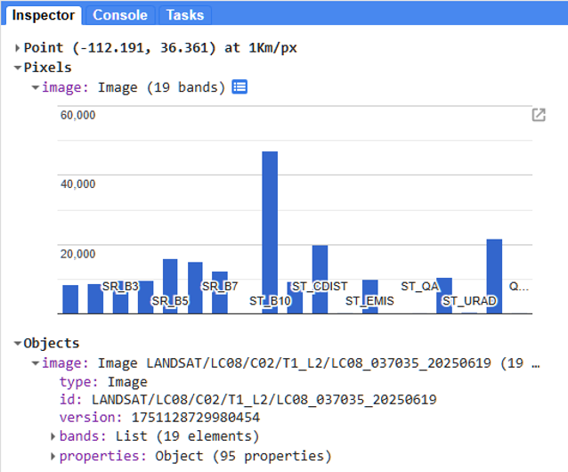
```

In the Inspector panel, open the *Objects* section, and click on *bands*. We can see that this Landsat 8 image contains 19 bands. Under *properties*, we can see that the image also includes a lot of metadata, such as `CLOUD_COVER`, `DATE_ACQUIRED`, `SUN_AZIMUTH`, etc. These properties will be useful for filtering image collections in the future. 

### Working With Image Collections 
We previously loaded one single Landsat image to the map. But the true power of GEE is in working with **image collections**, which can represent an entire catalogue of data from a specific satellite or database. 

Let’s use Landsat 8 once again. We can type the ID of the satellite into an `ee.ImageCollection()` object, much as we did above. But this time we can search for this collection using the search bar. In the upper search bar at the top of the code editor webpage, type “Landsat 8” and click Enter. There will be several results representing different processing levels. Find the dataset titled `USGS Landsat 8 Level 2, Collection 2, Tier 1`. 

```{r, echo=FALSE, fig.cap="Note: You can access any of the datasets in Google Earth Engine this way. The search bar is a way to explore GEE's petabytes of Earth data!"}
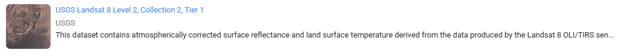
```

This dataset contains already pre-processed atmospherically corrected **surface reflectance** data, which is what we want to work with. Click on this search result to inspect the details of this dataset. Inside, there is a *Description*, list of *Bands*, *Properties*, and *Terms of Use*. By clicking on the *Bands* tab, we can inspect which of the bands we saw earlier correspond to which sections of the electromagnetic spectrum (blue, green, red, near infrared, shortwave infrared, etc.). We can also see the spatial resolution of the data, which here is 30 meters^2^.

Scrolling down, we can see on the lefthand side the period of *Dataset Availability* (2013-03-18 to present), the *Dataset Provider* (USGS), and a *Collection Snippet* which we can use to programmatically bring the dataset into our script. Copy the collection snippet, close this window, and let’s paste the snippet into the script. 

```{r, echo=FALSE}
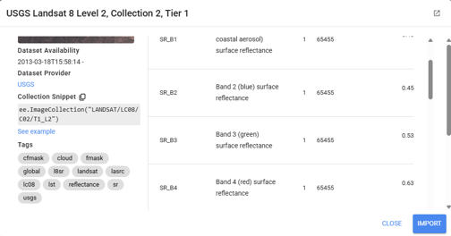
```

This code snippet creates a GEE **image collection** object, and we need only provide a variable name to contain it. In this case, we can assign this object the name `landsat8`. With one line of code, `landsat8` now contains ALL data in the Landsat 8 catalogue, spanning 2013 to present and covering the entire globe! 

```{js, eval=FALSE}
var landsat8 = ee.ImageCollection("LANDSAT/LC08/C02/T1_L2");
```

#### Filtering an Image Collection 
While having all of the data from Landsat 8 in one object is interesting, it’s not very useful. We need to filter the image collection to focus on the time and location of interest. We can filter spatially to focus on an area of interest, and temporally to narrow in on a particular timeframe. 

To apply a **spatial filter**, we will create an Earth Engine **Feature** object. The Map Display allows one way to do this manually. On the map panel, click the *Point* icon, then click a point of interest where you would like to see satellite imagery on your map. I’ll choose southern California near Los Angeles. 

```{r, echo=FALSE}
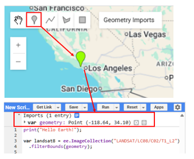
```

Once a point is placed, notice that it is automatically converted to a **Geometry Import**. It will appear under *Geometry Imports* on the map, and will also appear as *var geometry* at the imports section above your scripting panel. The same feature could have been created programmatically as well, for example: 
`var geometry = ee.Geometry.Point([-118.64,34.10]);`. 

This feature can now be used to filter the image collection to only include images which spatially intersect the created point. This is done by applying the method `.filterBounds()` to the Image Collection. 

```{js,eval=FALSE}
var landsat8 = ee.ImageCollection("LANDSAT/LC08/C02/T1_L2")
  .filterBounds(geometry);
```

With the Image Collection filtered spatially, the next step is to apply a **temporal filter**. To perform this, the method `.filterDate()` can be called and passed a date range as arguments. In this case the image collection will be filtered for dates in between `2024-11-01` and `2024-12-31`. 

```{js, eval=FALSE}
var landsat8 = ee.ImageCollection("LANDSAT/LC08/C02/T1_L2")
  .filterBounds(geometry) //spatial filter
  .filterDate("2024-11-01", "2024-12-31"); // temporal filter 
```

Notice how each filter can build on the last. With the spatial and temporal filter applied, we can now add the collection to the map using the following command and including the image visualization parameters from above. 

```{js, eval=FALSE}
Map.addLayer(landsat8, trueColorVis, "Landsat 8 Collection");
```

An image collection consists of multiple independent image objects. To inspect them, click on the *Inspector* tab of the upper-right panel. Then click on the data on your map. In this case, we can see in the Inspector panel that there are four image objects in the image collection. 

```{r, echo=FALSE}
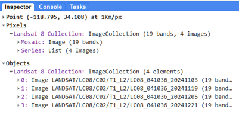
```

### Dealing with Clouds 
Take a look at your image collection on the map. You will likely only see the first image in the collection. Does it have any clouds? 

Clouds are an ever-present challenge when working with satellite data. Even if your area of interest is clear in the topmost image, there’s no guarantee it’s unobstructed in the other images of the collection. To handle this, we’ll explore three methods:

1.	**Median compositing:** Calculate the median pixel value across the collection. This often removes bright pixels caused by clouds, especially when there is a lot of data.
2.	**Filtering by attributes:** Remove images with high cloud cover using the metadata property.
3.	**Cloud masking:** Apply a mask that identifies and removes clouds at the pixel level.

#### Median Compositing 
The simplest way to reduce clouds in an image collection is to apply a mathematical operation across the entire collection. While this may sound complex, Earth Engine makes it straightforward.

Each band in an image can be thought of as a 2D array of pixel values, which allows mathematical operations to be applied across images. For an image collection, the `.median()` method reduces the collection to a single image by computing the median value at each pixel location. 

Because clouds tend to have high reflectance in optical imagery, they often appear as unusually bright values within a time series. By taking the median at each pixel, these outliers are suppressed, resulting in a composite image close to the true median surface reflectance values--particularly when there are many cloud-free images. 

Implement this by creating a new object called `landsat8_median`:

```{js, eval=FALSE}
var landsat8_median = ee.ImageCollection("LANDSAT/LC08/C02/T1_L2")
  .filterBounds(geometry)
  .filterDate("2024-11-01", "2024-12-31")
  .median();
```

The result of this operation is no longer an image collection, but a single image object. In GEE parlance, moving from a collection to a single image is referred to as [reducing](https://developers.google.com/earth-engine/guides/reducers_image_collection) the image collection. 

Visualize the resulting image using the same visualization parameters as above. Did the clouds disappear?

```{r, echo=FALSE}
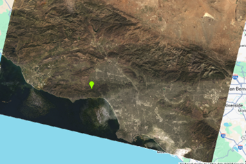
```

In this case, not entirely. This is due to the fact that there were only four images in the collection. However, in a sunny region like California, compositing across a longer time span would result in a much sharper image. What would it look like had we collapsed a year of data using this method? 

This approach is quick and effective for producing a general visual overview, but it can introduce distortions and results in the loss of potentially valuable temporal information. To handle clouds more precisely while preserving information through time, we can explore alternative methods.

#### Filtering by Image Properties 
Recall that each image includes a set of properties, which are metadata associated with the scene. Landsat data include the property `CLOUD_COVER`, which represents the estimated percentage of cloud cover for a given image. For example, if an image's property `CLOUD_COVER` = 40, then approximately 40% of the scene is estimated to be obscured by clouds based on USGS processing algorithms.

We can use this property to filter out images that are too cloudy for analysis. To do so, we append an additional filter step to the image collection:

```{js, eval=FALSE}
var landsat8 = ee.ImageCollection('LANDSAT/LC08/C02/T1_L2')
  .filterBounds(geometry)
  .filterDate('2024-11-01', '2024-12-31')
  .filter(ee.Filter.lt('CLOUD_COVER', 20));
```

Here, we use the `.filter()` method to apply an additional condition to the image collection. The condition is defined using `ee.Filter.lt()`, which selects images where a specified property is less than a given threshold. In this case, we use the `CLOUD_COVER` property to retain only images with less than 20% estimated cloud cover.

The resulting image collection contains only images that meet this condition, in addition to the spatial and temporal filters applied earlier. A cloud cover threshold of 20% may be sufficient for relatively cloud-free regions such as southern California, but the threshold can be adjusted depending on local climate conditions, data availability, and analysis objectives.

#### Cloud Masking 
A more robust way to handle clouds is by applying a **cloud mask**. Unlike simple filtering, which removes entire images, cloud masking operates at the pixel level, allowing us to retain useful observations within partially cloudy scenes.

To implement this approach, we first define a cloud masking function. This introduces an important Earth Engine concept: applying a function across all images in a collection using the `.map()` method.

For widely used sensors such as Landsat and Sentinel, well-tested cloud masking functions are readily available in the Earth Engine community and documentation. Here, we use a standard Landsat approach that leverages the `QA_PIXEL` band to identify clouds and cloud shadows based on quality assessment flags. For more information on the Landsat Quality Assessment (QA) bands and the bit flags used to identify clouds, cloud shadows, and other atmospheric conditions, see the [USGS Documentation](https://www.usgs.gov/landsat-missions/landsat-collection-2-quality-assessment-bands). 

To implement this, we first define the masking function. Add the following code at the top of your script:
```{js, eval=FALSE}
function maskL8sr(image) { // intake an image
  var qa = image.select('QA_PIXEL'); // select the QA pixel band

  // define the cloud mask using Landsat 8's included bitmap codes in the QA band  
  var cloudMask = qa.bitwiseAnd(1 << 1).eq(0) // Dilated cloud
    .and(qa.bitwiseAnd(1 << 2).eq(0))         // Cirrus
    .and(qa.bitwiseAnd(1 << 3).eq(0))         // Cloud
    .and(qa.bitwiseAnd(1 << 4).eq(0));        // Cloud shadow

  return image.updateMask(cloudMask); // return the masked image 
}
```

Now that we have defined a cloud masking function, we can apply it to every image in the collection. In GEE, this is known as mapping a function over an image collection.

This is done using the `.map()` method, which applies a function to each image in the collection and returns a new, processed collection as output. The following code applies both the cloudiness attribute filter and the cloud masking function to every image in the collection, resulting in a more robust approach to dealing with cloud cover.

```{js, eval=FALSE}
var landsat8 = ee.ImageCollection('LANDSAT/LC08/C02/T1_L2')
  .filterBounds(geometry)
  .filterDate('2024-11-01', '2024-12-31')
  .filter(ee.Filter.lt('CLOUD_COVER', 20)) 
  .map(maskL8sr);
```

How does the data look now with both the cloud cover filter and the cloud mask applied?

```{r, echo=FALSE}
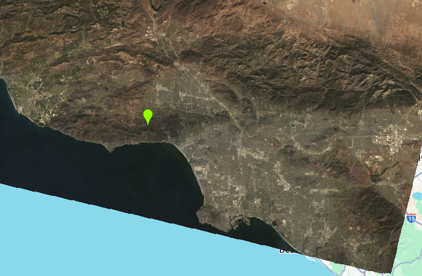
```

The image collection is now much cleaner and ready for analysis.

The dates and region selected here are intentional. The image precedes the destructive wildfires near Los Angeles in January 2025, which caused widespread damage across several communities. In the next exercise, we will use spectral band indices and change detection to map the extent and severity of this wildfire event and its impact on communities in the wildland-urban interface.

## Hands on: Satellite Change Detection Using GEE
GEE is particularly well suited for change detection, as it provides seamless access to large temporal ranges of satellite imagery and efficient tools for comparing observations across dates.

Change detection is a widely applied method in satellite image analysis, and enables the identification and quantification of environmental changes across space and time. This method is applied across several domains, including:

- **Wildfire assessment:** Mapping burn extent and severity before and after fire events
- **Deforestation and forest degradation:** Detecting tree cover loss, logging activity, or forest recovery
- **Urban expansion:** Tracking growth of cities and infrastructure over time
- **Agricultural dynamics:** Monitoring crop cycles, planting/harvest timing, and field abandonment
- **Flood mapping:** Identifying inundated areas during and after flood events
- **Drought impacts:** Observing vegetation stress and landscape drying over time
- **Glacier and snow cover change:** Measuring retreat or seasonal variability
- **Coastal change:** Tracking shoreline erosion, sediment movement, and sea level impacts

In this section, we will use change detection techniques to analyze wildfire severity and assess the extent of damage to communities in the wildland-urban interface during the 2025 Los Angeles wildfire. 

### Pre-Fire Imagery 
In Section 9.5.5, we learned how to create cloud-free composites using image collections, filtering, and masking techniques. We now apply these skills to analyze the 2025 Los Angeles wildfires by generating a high-quality pre-fire image image composite.

To do this, we use Landsat 8 data, apply filters to the image collection, perform image-based operations, and implement a cloud masking function. The following script produces a ready-to-use pre-fire composite based on these steps:

```{js, eval=FALSE}
// Cloud Mask Function
function maskL8sr(image) { // intake an image
  var qa = image.select('QA_PIXEL'); // select the QA pixel band
  var cloudMask = qa.bitwiseAnd(1 << 1).eq(0) // Dilated cloud
    .and(qa.bitwiseAnd(1 << 2).eq(0))         // Cirrus
    .and(qa.bitwiseAnd(1 << 3).eq(0))         // Cloud
    .and(qa.bitwiseAnd(1 << 4).eq(0));        // Cloud shadow
  return image.updateMask(cloudMask); // return the masked image 
}

// Define Area of Interest
var geometry = ee.Geometry.Point([-118.64,34.10]); 

// Landsat 8 Collection to Pre-fire Image
var landsat_pre = ee.ImageCollection('LANDSAT/LC08/C02/T1_L2')
  .filterBounds(geometry)
  .filterDate('2024-10-01', '2024-12-31')
  .filter(ee.Filter.lt('CLOUD_COVER', 20)) 
  .map(maskL8sr)
  .median();

// Visualization parameters
var trueColorVis = {
  bands: ["SR_B4","SR_B3","SR_B2"], // Red, Green, Blue bands
  min: 6000,
  max: 19000};

// Visualize Pre-Fire Image 
Map.addLayer(landsat_pre, trueColorVis, "Pre-Fire Image");
```

### Post-Fire Imagery 
To generate a post-fire image, we follow the same approach but select a time period after the fire event. The fires occurred between January 7 and 31, 2025, so we begin with February 2025 as our post-fire window. Using the same workflow, we can produce a clear post-fire composite.

Add the following code to the end of your script:

```{js, eval=FALSE}
// Post-Fire Image
var landsat_post = ee.ImageCollection('LANDSAT/LC08/C02/T1_L2')
  .filterBounds(geometry)
  .filterDate('2025-02-01', '2025-03-30')
  .filter(ee.Filter.lt('CLOUD_COVER', 20))
  .map(maskL8sr)
  .median();

// Visualize Post-Fire Image 
Map.addLayer(landsat_post, trueColorVis, "Post-Fire Image");
```

### Adjusting Visualization Parameters
You should now be able to compare the pre- and post-fire images on the map. Open the Layers panel in the upper-right corner and use the transparency slider for each layer to explore differences between them. Adjust the post-fire layer and observe how the landscape has changed.

Some of these differences are due to fire, while others reflect seasonal variation between the image acquisition dates. To better isolate fire-related changes, we can apply visualization techniques that specifically highlight burned areas.

Burned surfaces exhibit high reflectance in the *shortwave infrared (SWIR)* region, making them easier to identify using false color composites. To emphasize these fire scars, we will create a **false color visualization**. Append the following code to your script:

```{js, eval=FALSE}
// False color visualization with the SWIR and NIR bands
var swir_vis = {
  bands: ['SR_B7','SR_B5','SR_B4'], // SWIR, NIR, Red
  min: 7000,
  max: 20000};

// Add new visualizations 
Map.addLayer(landsat_pre, swir_vis,"Pre-fire false color");
Map.addLayer(landsat_post, swir_vis,"Post-fire false color");
```

```{r, echo=FALSE, fig.cap="False color visualizations take advantage of the multispectral nature of satellite data and can help highlight features that our eyes struggle to see in the visible spectrum."}
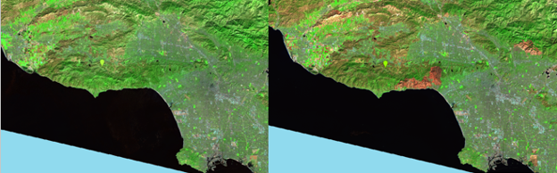
```

Toggle the post-fire false color layer on and off to compare it with the underlying imagery. You should observe areas where green vegetation gives way to bright red patches. These red regions indicate burned surfaces, which appear red in this visualization due to their high reflectance in the shortwave infrared (SWIR) region.

In this band combination, SWIR reflectance is displayed in red, near-infrared (NIR) reflectance in green, and red reflectance in blue.

### Calculating Indices Using Band Math 
One of the most common transformations applied to multispectral satellite data is the calculation of spectral indices. A widely used example is the **Normalized Difference Vegetation Index (NDVI)**.

As we have seen, individual spectral bands provide information about features on the Earth’s surface. However, additional insight can be gained by examining the relationship between bands, particularly through ratios of their values. In the case of vegetation, healthy plants strongly reflect radiation in the near-infrared (NIR) band while absorbing radiation in the red band.

NDVI leverages this contrast to provide an indicator of vegetation presence and density, and is calculated using the following formula:

```{r, echo=FALSE}
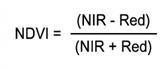
```

In this case, we are interested in burned areas. Here too, a useful index has been developed, the **Normalized Burn Ratio (NBR)**:

```{r, echo=FALSE}
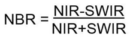
```

Since NIR reflectance is strongly associated with healthy vegetation, and SWIR reflectance increases over burned surfaces, the contrast between these bands provides a useful indicator of fire scars. This relationship is captured by the NBR, which is commonly used to map burned areas and estimate fire severity. ([Read more about NBR here.](https://un-spider.org/advisory-support/recommended-practices/recommended-practice-burn-severity/in-detail/normalized-burn-ratio))

Earth Engine provides a built-in method for calculating normalized difference indices. The `.normalizedDifference()` method computes the normalized difference between two bands. In the case of NBR, we use band 5 (NIR) and band 7 (SWIR). 

**Note:** To obtain accurate results, we must first apply a scaling function to the data. Landsat Collection 2 Surface Reflectance data are scaled by a factor of 0.0000275 + -0.2 [(see the scaling factor here)](https://www.usgs.gov/landsat-missions/landsat-collection-2-level-2-science-products), therefore we will first define a function to reverse this scaling. 

```{js, eval=FALSE}
// Apply Landsat Collection 2 surface reflectance scaling
function scaleL8sr(image) {
  var optical = image.select('SR_B.*') // select surface reflectance bands 
    .multiply(0.0000275)
    .add(-0.2);

  return image.addBands(optical, null, true);
}
```

Now, apply `scaleL8sr` and `.normalizedDifference()` to calculate the Normalized Burn Ratio for the pre- and post-fire image composites. 

```{js, eval=FALSE}
// Calculate NBR in pre- and post-fire images
var nbr_pre = landsat_pre
  .scaleL8sr()
  .normalizedDifference(['SR_B5', 'SR_B7'])
  .rename('NBR');
  
var nbr_post = landsat_post
  .scaleL8sr()
  .normalizedDifference(['SR_B5', 'SR_B7'])
  .rename('NBR');
```

### Calculate the differenced Normalized Burn Ratio (dNBR)
The change between pre-fire and post-fire NBR is referred to as the **differenced Normalized Burn Ratio (dNBR)**. It is calculated by subtracting the post-fire NBR from the pre-fire NBR. In Earth Engine, as with other mathematical operations on images, this can be implemented using the `.subtract()` method.

```{js, eval=FALSE}
// Calculate dNBR (pre - post)
var dnbr = nbr_pre.subtract(nbr_post);
Map.addLayer(dnbr);
```

The `dNBR` layer now represents change in NBR from pre- to post-fire. 

### Visualize Burn Severity 
dNBR has been widely used as an indicator of burn severity, with higher values generally corresponding to more severe fire impacts. The USGS has developed a standard classification scheme that relates ranges of dNBR values to categories of burn severity.

```{r, echo=FALSE}
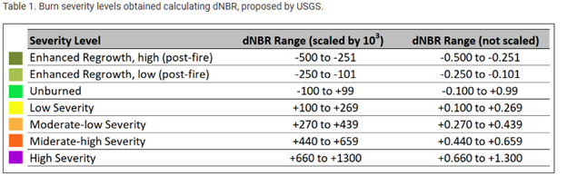
```

To visualize the dNBR values for this area of interest, we can mask any values below 0.1 to isolate only the burned area. Then we can apply visualization parameters that roughly align with USGS recommendations. Since the vegetation type in this region is chaparral, dNBR values will differ somewhat from the recommendations above.

```{js, eval=FALSE}
// Mask areas of non-fire (dNBR < 0.1) 
var dnbr_mask = dnbr.updateMask(dnbr.gt(0.1));

// dNBR Visualization parameters
var dnbrVis = {
  bands: ["NBR"],
  max: 0.6,
  min: 0.1,
  palette: ["fcff2b","ffc010","ff2218","fb0eff"]};

// Add the dNBR layer to the map
Map.addLayer(dnbr_mask,dnbrVis,"Fire Severity");
```

```{r, echo=FALSE}
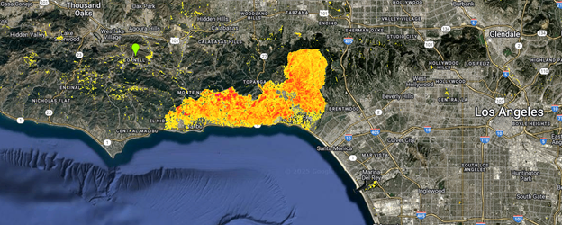
```

Explore the resulting dNBR map. From this data, it is apparent that two major fires occurred near Los Angeles: one to the north in the Altadena area (the Eaton fire), and another to the west of the city, affecting regions including Pacific Palisades and Malibu (the Palisades fire). The dNBR product effectively highlights these burn scars and captures the spatial extent of both events.

You may also notice some noise in the map, where isolated urban, forest, and particularly agricultural pixels appear as burned despite not being directly affected by wildfire. This type of “noisiness” is common in change detection workflows, especially when using simple differencing approaches. It can arise from seasonal differences, phenological change, atmospheric effects, or misregistration between images.

These limitations can be reduced using more advanced approaches, such as improved cloud and quality masking, threshold tuning, spatial filtering, or machine learning-based classification methods.

### Integrating Land Cover and Burn Severity 
While burn severity maps derived from dNBR clearly show where wildfire activity has occurred, they do not distinguish between different types of affected landscapes. To better understand wildfire impacts at the human–environment interface, we can combine burn severity with land cover information.

In particular, this allows us to identify where fire has intersected with urban areas, providing a direct view of impacts within the wildland–urban interface (WUI). By overlaying land cover classifications with burn severity, we can isolate burned urban pixels and more clearly assess how wildfire affected developed regions in and around Los Angeles.

#### Land Cover Data 
A suitable source of land cover information for this application is the USFS Landscape Change Monitoring System (LCMS). In Google Earth Engine, the LCMS provides land cover and land use classification products up to October 2024, immediately preceding the fire event analyzed here. The dataset is available at 30 m spatial resolution, which is consistent with the Landsat 8 imagery used for burn severity estimation, allowing for direct spatial comparison without resampling.

In this analysis, LCMS is used to provide contextual land cover information, enabling interpretation of burn severity patterns within different landscape types, particularly in relation to the wildland–urban interface. This is important because spectral burn indices alone do not distinguish between urban infrastructure, vegetation, or mixed land use areas.

The data can be accessed and displayed in a similar manner to the Landsat image collections:

```{js, eval=FALSE}
var landcover = ee.ImageCollection('USFS/GTAC/LCMS/v2024-10');

var lcms = landcover.sort('system:time_start', false) // sort the collection so latest image is "first"
               .filter('study_area == "CONUS"') // filter to continental US 
               .first(); // extract the first image 

Map.addLayer(lcms.select('Land_Use'), {}, 'Land Use'); // add the land use band using native visualization parameters
```

Visual comparison with high-resolution basemap imagery suggests that the LCMS classification provides reasonable spatial agreement for the study region. Here, the Land Use layer is used rather than the Land Cover layer, as it better captures semi-urban and transitional areas characteristic of the wildland–urban interface. However, it is important to note that this layer also includes infrastructure-related features such as roads, which may not correspond directly to built-up residential areas.

```{r, echo=FALSE}
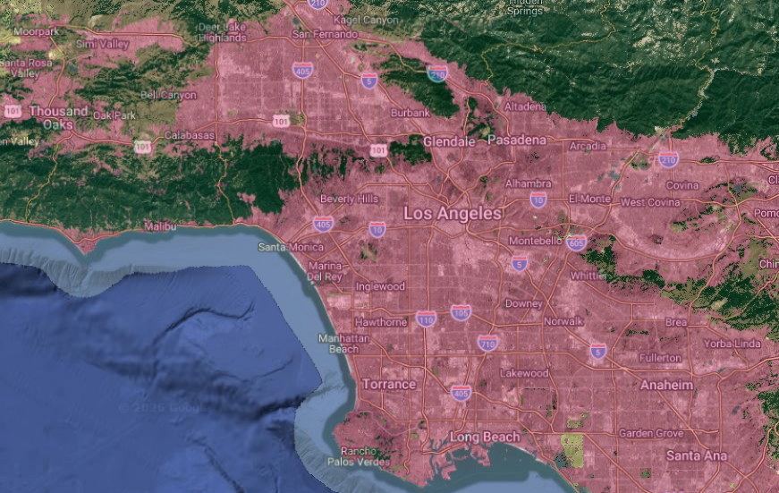
```

### Burned Areas in the Wildland-Urban Interface
With both burn severity (dNBR) and land use maps, we can now identify which neighborhoods in the WUI were burned in the 2025 Los Angeles fires. To accomplish this, we can simply update the **mask** of the dNBR data layer using the urban land use classification. 

```{js, eval=FALSE}
var urban = lcms.select('Land_Use').eq(2); // Select the land use band, then, urban land use is coded as 2
var urbanBurned = dnbr_mask.updateMask(urban); // mask the dNBR layer by urban areas
```

The result is a map of areas where urban land use class and burn areas indicated by dNBR coincide. Visualize the final result using the following command:

```{js, eval=FALSE}
Map.addLayer(urbanBurned,{palette:['ff150a']},"Urban Burned Areas");
```

```{r, echo=FALSE}
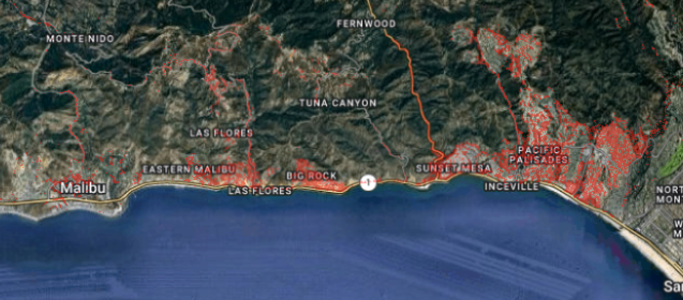
```

```{r, echo=FALSE}
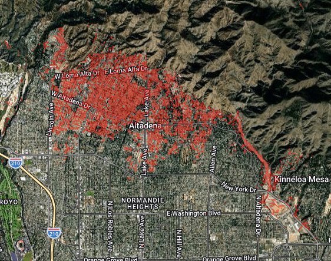
```

```{r, echo=FALSE}
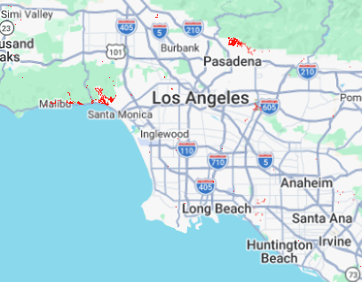
```


## Other Interfaces to the Earth Engine API

The Code Editor is the most convenient way to begin working with Earth Engine, but it is not the only one. The same Earth Engine backend can be accessed through several client libraries, each suited to a different workflow:

| Interface | Language | Best for |
|---|---|---|
| Code Editor | JavaScript | Exploratory work, sharing scripts, learning GEE |
| `earthengine-api` | Python | Reproducible analysis, integration with Python scientific stack, batch processing |
| `rgee` | R | R-based workflows, integration with the R spatial ecosystem (`sf`, `terra`, `stars`) |
| REST API | Any | Production pipelines, web applications, languages without a client library |

All four interfaces communicate with the same Earth Engine servers and produce identical results. The choice of interface is largely a matter of which ecosystem the rest of an analysis lives in.

### The Python API

For analyses that combine Earth Engine outputs with other Python libraries (e.g., `pandas`, `xarray`, `scikit-learn`, `geopandas`), the Python API is the most natural fit. It is also the recommended interface for batch processing and scheduled jobs.

#### Installation

The python client library is named `earthengine-api` and can be installed through `pip` or `conda`:

```{bash, eval=FALSE}
# pip
pip install earthengine-api

# conda
conda install -c conda-forge earthengine-api
```

For interactive map display in Jupyter notebooks, the `geemap` package is strongly recommended. It provides a Code-Editor-like map widget and a number of convenient functions:

```{bash, eval=FALSE}
pip install geemap
```

If you are using Google Colab, both packages are pre-installed.

#### Authentication and Initialization

The Python API requires a one-time authentication step per machine, followed by initialization with a Cloud project ID at the start of each session:

```{python, eval=FALSE}
import ee

# One-time per machine (opens a browser tab for OAuth)
ee.Authenticate()

# Required at the start of every session
ee.Initialize(project='your-project-id')

# Verify the connection
print(ee.String('Hello World!').getInfo())
```

The `project` argument should match the Cloud project ID created during account registration. If `ee.Initialize()` is called without a `project` argument, the call will fail with an error directing you to specify one.

#### A Parallel Example: Loading and Filtering an Image Collection

The Python API mirrors the JavaScript API closely. Object types, method names, and chaining patterns are nearly identical. The main syntactic differences are Python's snake_case for some helper functions, the use of dictionaries instead of object literals, and the explicit `getInfo()` call required to pull values to the client.

The same Landsat 8 cloud-masked composite produced earlier in this chapter can be produced as follows:

```{python, eval=FALSE}
import ee
import geemap

ee.Initialize(project='your-project-id')

# Cloud mask function - note the closer resemblance to the JS version
def mask_l8sr(image):
  qa = image.select('QA_PIXEL')
  cloud_mask = (qa.bitwiseAnd(1 << 1).eq(0) # Dilated cloud   
    .and(qa.bitwiseAnd(1 << 2).eq(0)) # Cirrus
    .and(qa.bitwiseAnd(1 << 3).eq(0)) # Cloud          
    .and(qa.bitwiseAnd(1 << 4).eq(0))) # Cloud shadow 
  return image.updateMask(cloud_mask)

# Define area of interest
geometry = ee.Geometry.Point([-118.64, 34.10])

# build the pre-fire composite
landsat_pre = (ee.ImageCollection('LANDSAT/LC08/C02/T1_L2')
               .filterBounds(geometry)
               .filterDate('2024-10-01', '2024-12-31')
               .filter(ee.Filter.lt('CLOUD_COVER', 20))
               .map(mask_l8sr)
               .median())
               
               
# Visualization parameters
true_color_vis = {
  'bands': ['SR_B4', 'SR_B3', 'SR_B2'],
  'min': 6000,
  'max': 19000
}

# Display in an interactive map
Map = geemap.Map()
Map.centerObject(geometry, 9)
Map.addLayer(landsat_pre, true_color_vis, 'Pre-Fire Image')
display(Map)
```

The structural similarity to the JavaScript version is intentional and reflects the fact that both client libraries are thin wrappers around the same underlying API.


#### Client vs. Server in Python

The client/server distinction introduced earlier in this chapter is particularly important to keep in mind when working in Python. Earth Engine objects are `server-side`: their values do not exist on the local machine and cannot be inspected directly with standard Python tools. For example, the following will not return what a Python user might expect:

```{python, eval=FALSE}
# This prints a description of the server-side object, NOT its value
print(landsat_pre)

# this actually retrieves the value from the server
print(landsat_pre.bandNames().getInfo())
```

Calls to `.getInfo()` block execution until a response is received from the server, and can be slow or fail entirely for large objects. As a rule of thumb, `getInfo()` should be used sparingly and only on small, scalar results. For larger outputs, use `ee.batch.Export` to write results to Google Drive, Google Cloud Storage, or as Earth Engine Assets.

### The R Interface: rgee

For users who prefer to remain in R, the `rgee` package provides an R binding for the Earth Engine API. `rgee` is a community-maintained package (part of the r-spatial ecosystem) rather than an official Google product, but it is well documented and stable, and integrates cleanly with the R spatial stack.

A practical caveat: `rgee` is implemented as a `reticulate` wrapper around the Python `earthengine-api`. This means that a working Python installation and the `earthengine-api` Python package are both required, even when working entirely in R. Setup is non-trivial on a fresh machine and is the most common source of friction reported by `rgee` users.

Installation and one-time setup:

```{r, eval=FALSE}
install.packages("rgee")
library(rgee)

# installs Python dependencies (numpy, earthengine-api) into a managed Python environment
ee_install()

# one-time authentication
ee_Authentication()
```

Once installed, the syntax mirrors the Python API, with `ee$` replacing `ee` for method access:

```{r, eval=FALSE}
library(rgee)
ee_Initialize(project = "your-project-id")

first_image <- ee$Image("LANDSAT/LC08/C02/T1_L2/LC08_037035_20250619")

true_color_vis <- list(
  bands = c("SR_B4", "SR_B3", "SR_B2"),
  min = 8000,
  max = 18000
)

Map$addLayer(first_image, true_color_vis, "First Image")
```

For more on `rgee`, including examples of pulling Earth Engine outputs directly into `sf` and `stars` objects, see the package documentation at <https://r-spatial.github.io/rgee/>. 


### REST API

The REST API is the lowest-level interface to Earth Engine, exposing the service as a set of standard HTTPS endpoints that return JSON. Unlike the client libraries, the REST API has no language-specific bindings - it can be called from any environment capable of making authenticated HTTP requests, including web applications, mobile clients, or languages without a maintained Earth Engine library (e.g., Julia, Go, Rust). 

For most analytical work, the REST API is *not* the recommended entry point. The JavaScript, Python, and R client libraries handle a substantial amount of complexity (object serialization, request batching, error handling) that must be implemented manually when working directly with REST. The REST API is most appropriate when:

- Building a web application that needs to embed Earth Engine outputs
- Integrating Earth Engine into a production pipeline written in a language without a client library
- Calling Earth Engine from a serverless or edge environment where installing a full Python or Node.js stack is undesirable. 

A minimal authenticated request to retrieve metadata for a single image might look like this in Python:


```{python, eval=FALSE}
import requests
import google.auth
import google.auth.transport.requests

# get application default credentials (set up via `gcloud auth login`)
credentials, project = google.auth.default()
credentials.refresh(google.auth.transport.requests.Request())

# construct the request
asset_id = 'LANDSAT/LC08/C02/T1_L2/LC08_037035_20250619'
url = f'https://earthengine.googleapis.com/v1/projects/{project}/assets/{asset_id}'

response = requests.get(
  url,
  headers = {'Authorization': f'Bearer {credentials.token}'}
)

print(response.json())
```


REST authentication is handled through standard Google Cloud OAuth2 flows and supports both user accounts and service accounts. Service accounts are typically preferred for automated or unattended workflows.

Full documentation of available endpoints is provided in the [GEE REST API Reference](https://developers.google.com/earth-engine/reference).

## GEE Exercises 

### Written Questions

**Suggested timing: Complete before lecture 2 of GEE Hands on Coding Exercises**

**Question 1:** How might or does GEE
intersect with your current research or future career goals? *(1 paragraph)*
</div>


<div id="ds-challenge" markdown="1">

**Question 2:** Consider either your current or future research, or a question you’d like to address during this course:

·       What climate data or additional phenological datasets would be valuable to address your research interests?

·       What challenges, if any, could you foresee when beginning to work with these data?


**Question 3:** Consider either your current or future research, or a question you would like to address during this course:

- What climate, remote sensing or other datasets available through GEE would be valuable for addressing your research interests?
- What challenges, if any, do you foresee when beginning to work with these data through Earth Engine?

**Question 4:** Compare the four interfaces to Earth Engine described in this chapter (Code Editor, Python API, `rgee`, REST API). For your own typical workflow, which interface would you choose, and why? Are there situations in which you would use more than one?

**Question 5:** The client/server distinction is one of the most important concepts to understand when working with Earth Engine. In your own words, explain what is meant by *client-side* vs. *server-side* operations, and give one example of each from the code in this chapter. 


### Exercise 1: Replicating Analysis Using Alternative Interfaces
Reproduce a simplified version of the wildfire change detection workflow from the Hands On section using either the Earth Engine **Python API** or the **R interface (rgee)**, and compare your results to the JavaScript output.

Specifically:

1. Set up a computational environment using Google Colab or Jupyter Notebook for Python, or RStudio for R.
2. Install and load the necessary packages (`earthengine-api` and `geemap` for Python, or `rgee` for R).
3. Authenticate and initialize the Earth Engine API.
4. Build pre-fire and post-fire Landsat 8 composites for the 2025 Los Angeles fire study area, using the same date ranges, area of interest, and cloud-masking function shown in this chapter.
5. Calculate the differenced Normalized Burn Ratio (dNBR).
6. Visualize the results using geemap (Python) or an appropriate mapping package in R, applying a similar visualization palette to the JavaScript example.
7. Submit your notebook (.ipynb) or knitted R markdown document along with a short (1–2 sentence) comparison: did the results match the JavaScript output? What differences, if any, did you observe?

This exercise is intended to reinforce that Earth Engine produces identical results across client libraries. The choice of interface affects workflow ergonomics but not the underlying analysis.

### Exercise 2: Integrating GEE into Ecoinformatics Workflows
Integrate analyses from GEE with environmental data from other research infrastructures. 

In this exercise, you will apply the skills learned in this chapter to connect GEE workflows with those from the other chapters of this textbook. 

**Suggested Research question:** How does vegetation productivity or greenness vary over time at an established environmental monitoring site, and how might these patterns relate to independently collected environmental observations?

**1. Identify an environmental monitoring site**    
Select an established monitoring site from another chapter of the textbook (e.g., NEON, LTER, or AmeriFlux).

Identify:    
* Geographic coordinates and spatial extent of the monitoring site    
* Available environmental observations (e.g., precipitation, temperature, phenology, fluxes, or ecosystem productivity)    
* Relevant temporal coverage    

**2. Access Earth Engine through an API interface**    
Identify the GEE API which will be most amenable to your workflow (JavaScript Code Editor, Python API, R interfeace). Then:

* Initialize the Earth Engine API
* Access a satellite dataset (such as Landsat or Sentinel-2)
* Filter imagery by geographic extent, date, and cloud cover
* Calculate a vegetation index (e.g., [NDVI](https://www.usgs.gov/landsat-missions/landsat-normalized-difference-vegetation-index))
* Generate a temporal summary of vegetation conditions at the monitoring site    
** *hint: a spatial reducer such as [reduce region](https://developers.google.com/earth-engine/guides/reducers_reduce_region) can provide a single average value at each time step*

**3. Integrate with external environmental data**    
Produce a visualization comparing satellite-derived vegetation dynamics with the selected environmental observations.

These data can be used to investigate questions such as:    
* Do seasonal changes in precipitation correspond with changes in vegetation greenness?    
* Is there a temporal lag between environmental conditions and vegetation responses?    
* How well do satellite-derived observations correspond with field-based measurements?    

**4. Submit**    
Submit your visualization with a brief written summary including which API choices you made and why, how you accessed and processed the data, and your interpretation of the results. 

### Culmination Activity

Write up a 1-page summary of a project you might want to explore using Google Earth Engine over the duration of this course. Your summary should include:

- A brief statement of the research question or applied problem
- The GEE datasets you would use, including spatial resolution, temporal range, and rationale
- Any non-GEE datasets you would integrate, and how they would be combined with GEE outputs
- The interface(s) you would use (Code Editor, Python, R, REST) and why
- Anticipated challenges, including data volume, cloud cover, processing time, or quota  limitations

Save this summary as you will be refining and adding to your ideas over the course of the semester.


