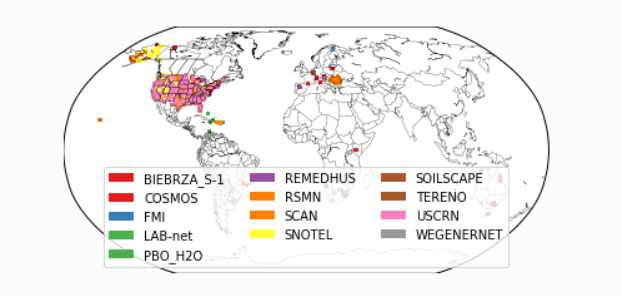
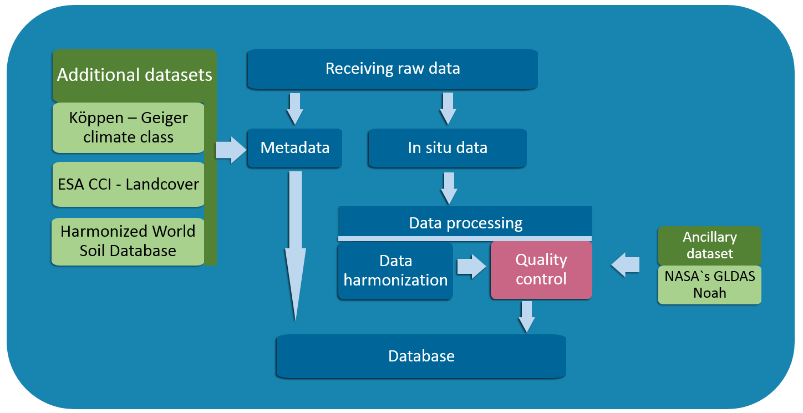
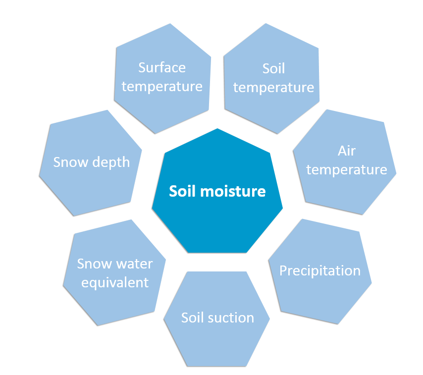
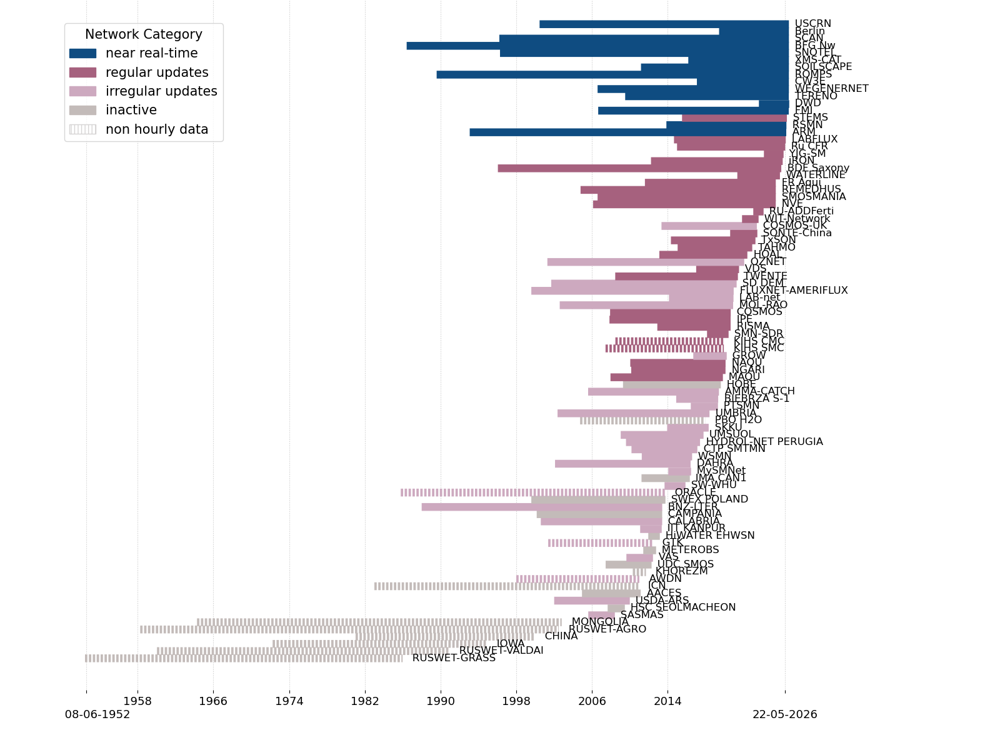
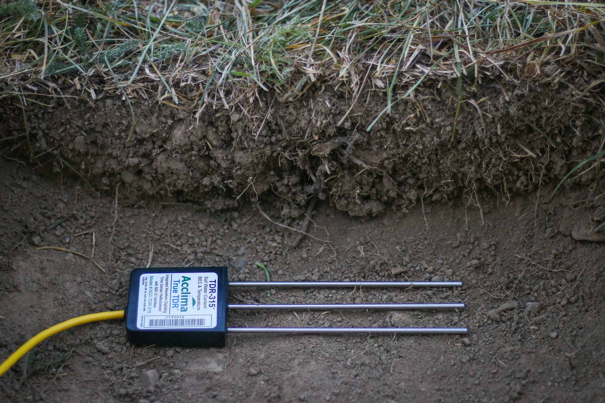
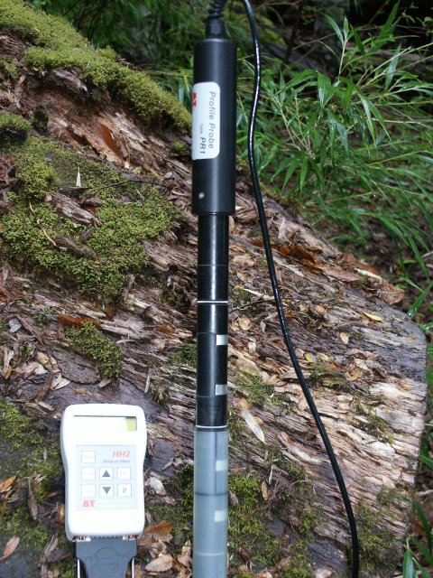
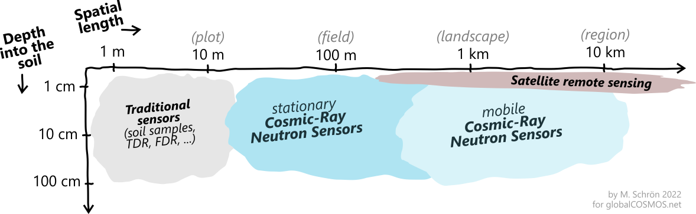
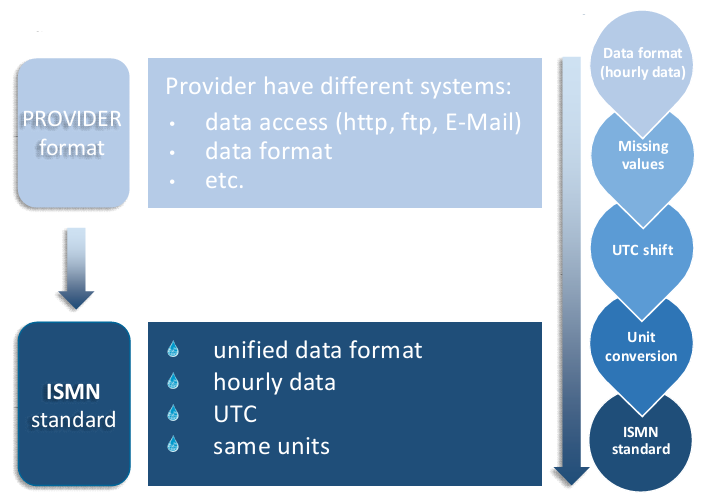

>Estimated time: 2 Hours

## Learning Objectives

<p>After completing this chapter, you will understand:</p>

<ul>
<li>What the International Soil Moisture Network is and its purpose.</li>
<li>The different processes used to measure soil moisture.</li>
<li>How to navigate the ISMN web portal and download data.</li>
<li>How to use the <code>ismn</code> Python package with downloaded data.</li>
</ul>

## The International Soil Moisture Network's Mission and Design

The International Soil Moisture Network is an infrastructure that compiles in situ soil data from across the globe into a centralized database. Data from dozens of different soil monitoring networks can be accessed on their website, and the data can be analyzed with their python package. It helps validate soil moisture data products from satellites, as well as being a database on its own. Along with soil moisture, the ISMN has expanded to have soil temperature and precipitation data among others, as well as information about soil properties in the metadata.

Founded at the TU Wien (Technical University of Wien), it now is operated by the Federal Institute of Hydrology (BfG) in Germany and the International Centre for Water Resources and Global Change (ICWRGC). 



>A map showing some of the networks in the ISMN. From the ISMN webpage. 


## Quality Assurance for Soil Moisture (QA4SM) Service
In addition to providing access to in situ soil moisture measurements, the ISMN is an important resource for validating satellite-derived soil moisture products. The Quality Assurance for Soil Moisture (QA4SM) service provides an interactive web-based platform for conducting these comparisons. Available at <https://qa4sm.eu/>, QA4SM allows users to evaluate satellite soil moisture products against ground-based observations from the ISMN, as well as reference datasets from land surface models and other sources. QA4SM also supports uploading custom datasets, allowing researchers to evaluate their own soil moisture products alongside the datasets already available within the platform. The service includes a [public API](https://qa4sm.eu/ui/public-api), which will not be covered in this chapter. 

## The Ecological Impacts of Soil Moisture

Soil moisture refers to the water stored within the soil, particularly in its upper layers, and plays a fundamental role in ecosystem functioning. It influences vegetation growth, nutrient cycling, microbial activity, and the exchange of water and energy between terrestrial ecosystems and the atmosphere. Soil moisture is also an important variable for understanding and predicting droughts, floods, weather patterns, and greenhouse gas emissions.

Soil water availability helps sustain diverse microbial communities, which drive important biogeochemical processes and contribute to soil structure and nutrient availability. Conversely, prolonged or severe soil moisture deficits can lead to plant stress and mortality, reduce microbial activity and diversity, and disrupt soil processes. These changes can trigger reinforcing feedback loops that further degrade soil conditions and reduce ecosystem resilience.

## Structure of the ISMN

The International Soil Moisture Network can be thought of as a “network of networks”, where thousands of local soil monitoring sites are compiled into one framework. Each country and network has their own way of recording data, which the ISMN accounts for in their harmonizing process. Some stations also measure additional features like precipitation and soil temperature along with moisture, which is also accessible in the same datasets.


### Networks in the ISMN
The ISMN is made up of many different ecological research infrastructures across the country, which vary in scale. Some networks like SNOTEL (SNOwpackTELemetryNetwork) and SOILSCAPE in the United States are very large, each having 509 and 224 stations respectively. Smaller networks can have as few as just one sensor, like BFG_Nw in Germany. 

Larger and more developed countries tend to have many networks within them, such as the United States, Germany the United Kingdom, and China. In other cases, networks can cross over international borders, such as the network ROMPS which has stations in Kyrgyzstan, Tajikistan, Uzbekistan, and Afghanistan.

A comprehensive list of all the networks in the ISMN can be found at: <https://ismn.earth/en/networks/>

### Data Viewer and Web Portal

[The ISMN Web Portal](https://ismn.earth/en/) that contains most information from this chapter, as well as the data viewer and downloader. Here, there is metadata information about all the networks, visualizations of data, and information about the ISMN and their tools as a whole. 

The web portal will be accessed later in this tutorial to download data. Also here is more information on the ISMN python package. 

### The ISMN's Methodology
The ISMN contains surface and subsurface in-situ soil moisture data, collected across the globe. Since the data comes from different countries with different practices, it needs to be harmonized in terms of units. Then, advanced quality control is applied to the data, and it gets uploaded to the online database, with free public access. Quality flags that get used by the ISMN are explored later in this chapter. Additional metadata datasets are included for each station, which are the Köppen Geiger climate class, Harmonized World Soil Database, and ESA’s CCI landcover.  



>A depiction of how data is compiled from various sources into the ISMN database. Sourced from the ISMN website.


### Metadata
Mandatory metadata information for each station comes from both the network operators as well as external data sources. For instance, soil properties, land cover and consistent climate are taken from external sources to provide consistency across all networks, and network operators can provide additional information on these. Network operators can also share quality control flags, which can all be accessed via the python tool (developed by TU Wien).

For each station in the database, soil moisture data is available from the surface down to deeper soil layers; the number of depths and the exact depths measured depend on the setup of the specific network. Along with soil moisture, stations can additionally measure soil temperature, air temperature, precipitation, soil suction, snow water equivalent, snow depth and surface temperature. These features are not available on all stations, but when so, they are accessible via the python tool. 



>Depiction of focus of ISMN data, a focus around soil moisture with additional features surrounding. Sourced from ISMN website


Networks are updated over ranges of times, some being daily, some monthly or every few months, and others at irregular intervals. It is preferred that data can be provided every hour, but that is not always the case. For historical data, there are usually only measurements once or twice a month, or even more irregular. 



>A graph showing frequency of readings per network. From the ISMN webpage.


### Additional Metadata Datasets 
As mentioned before, to get consistent metadata across networks, external data sources are used. 

**Harmonized World Soil Database (HWSD) -** Used to retrieve soil information with 30’’ resolution (version v1.1).

**CCI Landcover Classes -** Land covers retrieved from ESA’s Climate Change Initiative, with 300m resolution (versions: 2000-v1.6.1, 2005-v1.6.1, 2010-v1.6.1). 

**Köppen-Geiger Climate Classes -** Classifications of climates from the Köppen-Geiger database with an accuracy of 0.1 to 0.08 degrees respectively.  

**Soil and Landcover Information from Data Providers (not applicable to all networks) -** When available, data providers and network operators may give their own measurements for climate, landcover etc. to go along with the data collected from previously mentioned sources. 


### How Soil Data is Collected

There are several techniques for measuring in situ soil moisture, the most commonly used are: frequency domain reflectance (FDR), time domain reflectometry (TDR) and capacitance, all measuring the dielectric properties of the soil, and cosmic-ray neutron sensors (CRNS). Regardless of the methods, they all result in volumetric soil moisture content, which can fit into the ISMN dataset. 

**Time Domain Reflectance (TDR) -** Measures how fast electromagnetic pulses travel through soil, wetter soil slows them down. TDR is a very accurate method, and widely used in research. This is done by inserting metal rods horizontally at various depths in the soil then sends pulses down them, waiting for the return. The holes then get filled back in, and the sensors are usually then connected to a data logger which can regularly measure and record readings. The rods can also be inserted vertically at the surface(Rasheed 2022).

TDR systems do not need to account for any contents of the soil, nor do they need to be calibrated. This makes them very useful for spot measurements, without having to dig a hole and set up a sub-surface system(Rasheed 2022).



>A TDR device in a hole about to be installed. Image courtesy of https://harvest.com/gallery/.


**Frequency Domain Reflectometry (FDR) / Capacitance -** Frequency domain reflectometry is very similar to TDR, except it uses an oscillating electric field rather than individual pulses. On top of that, FDR systems are cheaper, simpler, and requiere less power, making them popular for field use especially for long term temporal measurements(Rasheed 2022).

However, FDR systems are more sensitive to the contents of the soil, and can cause larger error if there is high salinity or mineral content(Rasheed 2022).



>An FDR device out of the soil, courtesy of the Soil Moisture - FDR (Profile Probe) wikipedia page.

**Cosmic-Ray Neutron Sensors (CRNS) -** CRNS systems measure the amount of fast moving neutrons over a desired site. Soil moisture reduces the amount of fast moving neutrons. Mounted sensors above the ground measure the neutron flux over the site. A site can have a radius up to 240 meters, and a depth of up to 80 cm. A network that utilizes CRNS in the ISMN are the COSMOS networks, which are COSMOS (US) and COSMOS-UK, totaling 158 stations between them. To read more on CRNS and the COSMOS networks, see <https://globalcosmos.github.io/>.  



>A infographic showing ranges of multiple soil moisture detection systems, including stationary and mobile CRNS systems. Image courtesy of Global COSMOS.net (<https://globalcosmos.github.io/)>.


### Data Quality
The ISMN uses quality flags to mark “dubious” data. There are two categories of flags, C and D. C flags are automatically assigned when a reading passes a certain threshold, making it suspicious. D flags are used in more case-by-case events, like strange spikes, or peaking soil moisture without any precipitation events. Reference <https://ismn.earth/en/data/flag-overview/> for more in-depth information on ISMN data flags. 

When downloading data from the ISMN data viewer, there are options to filter out anything except "good" data, which isn't flagged. 


### Harmonization
Since there are no standardizations across networks, the ISMN has to process all of it domestically. When it comes to measuring soil moisture, there are many definitions such as: volumetric, water depth, mass, Soil Moisture Index, and plant available water. On top of that, there are different installation depths and positions (horizontal and vertical) among many other things. Because of this, datasets are harmonized in time, and in measurement units. 

All soil moisture data in the ISMN database are in (m3/m-3), which is the most commonly used unit. Other measurements get their own respective standards which they get harmonized to. For time, all measurements are converted to Coordinated Universal Time (UTC). 

Measurements that fall outside of normal ranges get labeled with quality flags, and datasets are harmonized to an hourly timestep NaN values (Not a Number) or missing timesteps are possible). 



>An infographic depicting the process of harmonizing data for the ISMN. Courtesy the ISMN website. 


## Downloading data from the ISMN Website
Website link: <https://ismn.earth/en/>

The first step of working with ISMN data is downloading from the website. To do so, you will need to create an account and sign in (it's free).

From the home page, click on the “data access” button, and make sure that you are signed into your account. From there, you should be looking at the data viewer window with all available networks, something like this:


>Image captured from ISMN data viewer/downloader.


On the left side, there are settings to select what networks will be included in the download, such as inputting coordinates, checking boxes, or drawing out areas on the map. There are also settings like including all climates, land covers etc. At the very bottom right of the window, it shows how many time series are being selected.


>Image from ISMN tool manual.


For the tutorial later in the chapter, we will only be selecting a handful of sites from Europe, visible in the picture below. These sites are FMI, GTK, REMEDHUS, RSMN, SMOSMANIA, VAS and WEGENERNET. For the time range, we will be using January 1, 2009, to December 31, 2020. Be sure to check the All variables, all climates and all land covers on the “more options” page too. Then click the “Download” button, and the screen below should appear.


>Image captured from ISMN data viewer/downloader.


On this page DO NOT check the gap filling with NaN box, and the other boxes do not matter too much, for this tutorial the quality flags being at least good is used. Once everything looks good, click Download. The process can take a few minutes to complete. In the bottom right corner, there is a “your requests” button which has the links of your requests, which you will need to download, which will take a few more minutes. Links to download can also be found in your account’s email, depending on the time taken to download. Once the .zip file is on your local machine, you are ready to begin coding. You do not need to unzip this folder and take note of its path.

## Hands On Part 1: Intro to the ```ismn``` Python Library
Now, we will begin the hands on coding exercise in Python. In this segment, we will work with the data downloaded from the tutorial above to examine it's structure and create graphs. 

### Python Requirements
Unlike other sections throughout the textbook, this section uses Python. If you have not used Python on your local machine before, you will first need to install it. Python can be downloaded from the official website (<https://www.python.org/downloads/>). Alternatively, you can install Python through the Anaconda distribution (<https://www.anaconda.com/download>), which provides Python along with tools for managing packages and computational environments.

```python --version```

For this tutorial, Python version 3.12 was used, along with Jupyter Notebook as the development environment (IDE). Jupyter Notebook provides an interactive environment where Python code can be executed in individual cells, making it particularly useful for data analysis and visualization.

To install Jupyter Notebook using pip, run the following command in your terminal:

```pip install notebook```

Once installed, you can launch Jupyter Notebook by running:

```jupyter notebook```

You are welcome to use another Python development environment, such as Visual Studio Code or JupyterLab, provided it supports running Python code. Regardless of which environment you choose, make sure it can access the .zip file downloaded from the ISMN website, as this file will be used throughout the tutorial.

### Data Prepping
First, let's import required packages. The main focus is the ```ISMN_Interface``` function, which comes from the ```ismn``` package. This can be downloaded using ```pip install ismn``` from the command line. In this tutorial, we will also be using the ```numpy``` and ```matplotlib``` packages which also need their own downloads using ```pip```. Source code is from the ISMN's coding tutotial located at: https://ismn.readthedocs.io/en/latest/examples/interface.html


```python
from ismn.interface import ISMN_Interface
import numpy as np
import matplotlib.pyplot as plt  # matplotlib is not installed automatically
%matplotlib inline
```

For cleanliness, let's get the path to the local .zip file that was downloaded from the web portal. Be sure to keep it as is from the download. Change this path to wherever you saved the .zip file.


```python
FILE_PATH="Downloads/Data_separate_files_header_20090101_20201231_13318_PEr6_20260403.zip"
```

After downloading data from the ISMN website, let's use the ```ISMN_Interface``` function to extract the .zip file, and store it in a data structure. From this data structure, many other tools from the ismn python library can be used on it. 


```python
ismn_data = ISMN_Interface(FILE_PATH)
```

    Using the existing ismn metadata in Downloads\python_metadata\Data_separate_files_header_20090101_20201231_13318_PEr6_20260403.csv to set up ISMN_Interface. 
    If there are issues with the data reader, you can remove the metadata csv file to repeat metadata collection.
    

### Data Organization
Let's take a look at the object to make sure everything got dowloaded correctly. In the output below, it looks like all of the sites in the networks that we selected are in our dataframe.


```python
ismn_data
```


    ismn.base.IsmnRoot Zip at Downloads\Data_separate_files_header_20090101_20201231_13318_PEr6_20260403.zip
    with Networks[Stations]:
    ------------------------
      FMI: ['SAA111', 'SAA112', 'SAA120', 'SOD011', 'SOD012', 'SOD013', 'SOD021', 'SOD022', 'SOD023', 'SOD031', 'SOD032', 'SOD033', 'SOD071', 'SOD072', 'SOD073', 'SOD081', 'SOD082', 'SOD083', 'SOD091', 'SOD092', 'SOD093', 'SOD101', 'SOD102', 'SOD103', 'SOD130', 'SOD140', 'SODAWS'],
      GTK: ['IlomantsiII', 'Kuusamo', 'PoriII', 'Suomussalmi'],
      REMEDHUS: ['Canizal', 'Carramedina', 'Carretoro', 'CasaPeriles', 'ConcejodelMonte', 'ElCoto', 'ElTomillar', 'Granja-g', 'Guarena', 'Guarrati', 'LaAtalaya', 'LaCruzdeElias', 'LasArenas', 'LasBodegas', 'LasBrozas', 'LasEritas', 'LasTresRayas', 'LasVacas', 'LasVictorias', 'LlanosdelaBoveda', 'Paredinas', 'Zamarron'],
      RSMN: ['Adamclisi', 'Alexandria', 'Bacles', 'Banloc', 'Barlad', 'Calarasi', 'ChisineuCris', 'Corugea', 'Cotnari', 'Darabani', 'Dej', 'Dumbraveni', 'Iasi', 'Oradea', 'RosioriideVede', 'SannicolauMare', 'SatuMare', 'Slatina', 'Slobozia', 'Tecuci'],
      SMOSMANIA: ['Barnas', 'Berzeme', 'CabrieresdAvignon', 'Condom', 'CreondArmagnac', 'LaGrandCombe', 'Lahas', 'LezignanCorbieres', 'Mazan-Abbaye', 'Mejannes-le-Clap', 'Montaut', 'Mouthoumet', 'Narbonne', 'PeyrusseGrande', 'Pezenas', 'Pezenas-old', 'Prades-le-Lez', 'Sabres', 'SaintFelixdeLauragais', 'Savenes', 'Urgons', 'Villevielle'],
      VAS: ['MelbexI', 'MelbexII'],
      WEGENERNET: ['15', '19', '27', '34', '50', '54', '6', '77', '78', '84', '85', '99']


Within the dataframe, we can see seven subsections. These are the different networks that we selected when downloading the data from the web portal. The networks can be indexed with both integers as well as their strings, same thing goes for their stations within them. Let's choose the 'SMOSMANIA' network, and examine it.


```python
smos_data = ismn_data["SMOSMANIA"]
smos_data
```


    Network 'SMOSMANIA' with Stations: ['Barnas', 'Berzeme', 'CabrieresdAvignon', 'Condom', 'CreondArmagnac', 'LaGrandCombe', 'Lahas', 'LezignanCorbieres', 'Mazan-Abbaye', 'Mejannes-le-Clap', 'Montaut', 'Mouthoumet', 'Narbonne', 'PeyrusseGrande', 'Pezenas', 'Pezenas-old', 'Prades-le-Lez', 'Sabres', 'SaintFelixdeLauragais', 'Savenes', 'Urgons', 'Villevielle']


Now, let's do a little more investigation on the network. From the SMOSMANIA network, let's look at the SaintFelixdeLauragais station's sensor data. By just passing the station name, we can see all of the sensors at the station. 


```python
smos_data["SaintFelixdeLauragais"]
```


    Station 'SaintFelixdeLauragais' with Sensors: ['ThetaProbe-ML2X_soil_moisture_0.050000_0.050000', 'PT-100_soil_temperature_0.050000_0.050000', 'ThetaProbe-ML2X_soil_moisture_0.100000_0.100000', 'PT-100_soil_temperature_0.100000_0.100000', 'ThetaProbe-ML2X_soil_moisture_0.200000_0.200000', 'PT-100_soil_temperature_0.200000_0.200000', 'ThetaProbe-ML2X_soil_moisture_0.300000_0.300000', 'PT-100_soil_temperature_0.300000_0.300000', 'ThetaProbe-ML3_soil_moisture_0.200000_0.200000']


### Station Metadata
To see that station's metadata, simply add ` .metadata ` onto the end of it, and we can see more information on the station. Lots of information regarding the soil makeup and instrument data is present here. We can also see landcover and climate information of the station too.


```python
smos_data["SaintFelixdeLauragais"].metadata
```


    MetaData([
      MetaVar([clay_fraction, 22.8, Depth([0.05, 0.05])]),
      MetaVar([climate_KG, Cfb, None]),
      MetaVar([climate_insitu, unknown, None]),
      MetaVar([elevation, 337.0, None]),
      MetaVar([instrument, ThetaProbe-ML2X, Depth([0.05, 0.05])]),
      MetaVar([latitude, 43.4417, None]),
      MetaVar([lc_2000, 10, None]),
      MetaVar([lc_2005, 10, None]),
      MetaVar([lc_2010, 10, None]),
      MetaVar([lc_insitu, unknown, None]),
      MetaVar([longitude, 1.88, None]),
      MetaVar([network, SMOSMANIA, None]),
      MetaVar([organic_carbon, 1.15, Depth([0.05, 0.05])]),
      MetaVar([sand_fraction, 43.5, Depth([0.05, 0.05])]),
      MetaVar([saturation, 0.44, Depth([0.05, 0.05])]),
      MetaVar([silt_fraction, 33.7, Depth([0.05, 0.05])]),
      MetaVar([station, SaintFelixdeLauragais, None]),
      MetaVar([timerange_from, 2009-01-01 00:00:00, None]),
      MetaVar([timerange_to, 2020-12-31 00:00:00, None]),
      MetaVar([variable, soil_moisture, Depth([0.05, 0.05])]),
      MetaVar([instrument, PT-100, Depth([0.05, 0.05])]),
      MetaVar([variable, soil_temperature, Depth([0.05, 0.05])]),
      MetaVar([clay_fraction, 22.4, Depth([0.1, 0.1])]),
      MetaVar([instrument, ThetaProbe-ML2X, Depth([0.1, 0.1])]),
      MetaVar([organic_carbon, 0.84, Depth([0.1, 0.1])]),
      MetaVar([sand_fraction, 40.3, Depth([0.1, 0.1])]),
      MetaVar([saturation, 0.43, Depth([0.1, 0.1])]),
      MetaVar([silt_fraction, 37.3, Depth([0.1, 0.1])]),
      MetaVar([variable, soil_moisture, Depth([0.1, 0.1])]),
      MetaVar([instrument, PT-100, Depth([0.1, 0.1])]),
      MetaVar([variable, soil_temperature, Depth([0.1, 0.1])]),
      MetaVar([clay_fraction, 23.9, Depth([0.2, 0.2])]),
      MetaVar([instrument, ThetaProbe-ML2X, Depth([0.2, 0.2])]),
      MetaVar([organic_carbon, 0.97, Depth([0.2, 0.2])]),
      MetaVar([sand_fraction, 39.7, Depth([0.2, 0.2])]),
      MetaVar([saturation, 0.44, Depth([0.2, 0.2])]),
      MetaVar([silt_fraction, 36.4, Depth([0.2, 0.2])]),
      MetaVar([timerange_to, 2017-09-01 11:00:00, None]),
      MetaVar([variable, soil_moisture, Depth([0.2, 0.2])]),
      MetaVar([instrument, PT-100, Depth([0.2, 0.2])]),
      MetaVar([variable, soil_temperature, Depth([0.2, 0.2])]),
      MetaVar([clay_fraction, 29.4, Depth([0.3, 0.3])]),
      MetaVar([instrument, ThetaProbe-ML2X, Depth([0.3, 0.3])]),
      MetaVar([organic_carbon, 0.7, Depth([0.3, 0.3])]),
      MetaVar([sand_fraction, 32.0, Depth([0.3, 0.3])]),
      MetaVar([saturation, 0.44, Depth([0.3, 0.3])]),
      MetaVar([silt_fraction, 38.6, Depth([0.3, 0.3])]),
      MetaVar([variable, soil_moisture, Depth([0.3, 0.3])]),
      MetaVar([instrument, PT-100, Depth([0.3, 0.3])]),
      MetaVar([variable, soil_temperature, Depth([0.3, 0.3])]),
      MetaVar([instrument, ThetaProbe-ML3, Depth([0.2, 0.2])]),
      MetaVar([timerange_from, 2017-10-16 13:00:00, None])
    ])


### Sensor Data
Now, let's look at some actual soil moisture data from a sensor at the SaintFelixdeLauragais station. To access it, we use a similar function, just ``` .data ``` this time. To get data from the first sensor at the station, we are choosing the 0th index.

In the output, we can see the data is from the dates we chose to download the data from, and all of the flags are "G" for good. 


```python
smos_data["SaintFelixdeLauragais"][0].data
```


<div>
<style scoped>
    .dataframe tbody tr th:only-of-type {
        vertical-align: middle;
    }

    .dataframe tbody tr th {
        vertical-align: top;
    }

    .dataframe thead th {
        text-align: right;
    }
</style>
<table border="1" class="dataframe">
  <thead>
    <tr style="text-align: right;">
      <th></th>
      <th>soil_moisture</th>
      <th>soil_moisture_flag</th>
      <th>soil_moisture_orig_flag</th>
    </tr>
    <tr>
      <th>date_time</th>
      <th></th>
      <th></th>
      <th></th>
    </tr>
  </thead>
  <tbody>
    <tr>
      <th>2009-01-01 00:00:00</th>
      <td>0.2957</td>
      <td>G</td>
      <td>M</td>
    </tr>
    <tr>
      <th>2009-01-01 01:00:00</th>
      <td>0.2957</td>
      <td>G</td>
      <td>M</td>
    </tr>
    <tr>
      <th>2009-01-01 02:00:00</th>
      <td>0.2957</td>
      <td>G</td>
      <td>M</td>
    </tr>
    <tr>
      <th>2009-01-01 03:00:00</th>
      <td>0.2952</td>
      <td>G</td>
      <td>M</td>
    </tr>
    <tr>
      <th>2009-01-01 04:00:00</th>
      <td>0.2952</td>
      <td>G</td>
      <td>M</td>
    </tr>
    <tr>
      <th>...</th>
      <td>...</td>
      <td>...</td>
      <td>...</td>
    </tr>
    <tr>
      <th>2020-12-30 20:00:00</th>
      <td>0.2710</td>
      <td>G</td>
      <td>M</td>
    </tr>
    <tr>
      <th>2020-12-30 21:00:00</th>
      <td>0.2700</td>
      <td>G</td>
      <td>M</td>
    </tr>
    <tr>
      <th>2020-12-30 22:00:00</th>
      <td>0.2710</td>
      <td>G</td>
      <td>M</td>
    </tr>
    <tr>
      <th>2020-12-30 23:00:00</th>
      <td>0.2700</td>
      <td>G</td>
      <td>M</td>
    </tr>
    <tr>
      <th>2020-12-31 00:00:00</th>
      <td>0.2700</td>
      <td>G</td>
      <td>M</td>
    </tr>
  </tbody>
</table>
<p>97750 rows × 3 columns</p>
</div>


# Hands On Part 2: Built-In ISMN Functions & Plotting Sensor Timeseries Data
In this section, we will plot & examine data from various sensors, as well as introduce other supplemental functions in the ``` ismn ``` python library. 


## Plotting Sensor Data
Now, let's examine a sensor at the SaintFelixdeLauragais station. The available sensors to pick from are visible from sections before, here we chose the "ThetaProbe-ML2X_soil_moisture_0.050000_0.050000" sensor. After getting the sensor as an object, let's turn it's metadata into a PANDAS dataframe. Then, we will plot the sensor's soil moisture data as a time series. 

In the output, we see a the metadata for the sensor, as well as a simple time series of measurements from that specific sensor. That gap around 2011 in the time series could be caused from various reasons like dubious data or sensor malfunctions.


```python
# print the sensor's metadata
sensor = ismn_data['SMOSMANIA']['SaintFelixdeLauragais']['ThetaProbe-ML2X_soil_moisture_0.050000_0.050000']
print(sensor.metadata.to_pd())

# plot the stations data
ax = sensor.data.plot(figsize=(12,4))

# add labels
ax.set_xlabel("Time [year]")
ax.set_ylabel("Soil Moisture [$m^3 m^{-3}$]")

```

    variable        key       
    clay_fraction   val                            22.8
                    depth_from                     0.05
                    depth_to                       0.05
    climate_KG      val                             Cfb
    climate_insitu  val                         unknown
    elevation       val                           337.0
    instrument      val                 ThetaProbe-ML2X
                    depth_from                     0.05
                    depth_to                       0.05
    latitude        val                         43.4417
    lc_2000         val                              10
    lc_2005         val                              10
    lc_2010         val                              10
    lc_insitu       val                         unknown
    longitude       val                            1.88
    network         val                       SMOSMANIA
    organic_carbon  val                            1.15
                    depth_from                     0.05
                    depth_to                       0.05
    sand_fraction   val                            43.5
                    depth_from                     0.05
                    depth_to                       0.05
    saturation      val                            0.44
                    depth_from                     0.05
                    depth_to                       0.05
    silt_fraction   val                            33.7
                    depth_from                     0.05
                    depth_to                       0.05
    station         val           SaintFelixdeLauragais
    timerange_from  val             2009-01-01 00:00:00
    timerange_to    val             2020-12-31 00:00:00
    variable        val                   soil_moisture
                    depth_from                     0.05
                    depth_to                       0.05
    Name: data, dtype: object
    


    Text(0, 0.5, 'Soil Moisture [$m^3 m^{-3}$]')


    

    


## Finding the Nearest Station
The ``` ISMN_Interface ``` object contains information on all stations in the selected area, including coordinates. Closest stations to given points can be found using the function ``` get_nearest_station ```. In the output below, we can see coordinates for all of the stations across the 7 networks that we downloaded data from. Keep in mind when using this function, it will only return a station that has been downloaded. 


```python
import pandas as pd

# look at stations geocoordinates
grid = ismn_data.collection.grid
gpis, lons, lats, _ = grid.get_grid_points()

# turn into a pandas dataframe and print
pd.DataFrame(index=pd.Index(gpis, name='gpi'),
             data={'lon': lons, 'lat': lats}).T
```


<div style="width: 100%; overflow-x: auto;">
<style scoped>
    .dataframe tbody tr th:only-of-type {
        vertical-align: middle;
    }

    .dataframe tbody tr th {
        vertical-align: top;
    }

    .dataframe thead th {
        text-align: right;
    }
</style>
<table border="1" class="dataframe">
  <thead>
    <tr style="text-align: right;">
      <th>gpi</th>
      <th>0</th>
      <th>1</th>
      <th>2</th>
      <th>3</th>
      <th>4</th>
      <th>5</th>
      <th>6</th>
      <th>7</th>
      <th>8</th>
      <th>9</th>
      <th>...</th>
      <th>99</th>
      <th>100</th>
      <th>101</th>
      <th>102</th>
      <th>103</th>
      <th>104</th>
      <th>105</th>
      <th>106</th>
      <th>107</th>
      <th>108</th>
    </tr>
  </thead>
  <tbody>
    <tr>
      <th>lon</th>
      <td>27.55062</td>
      <td>27.55076</td>
      <td>27.53543</td>
      <td>26.63378</td>
      <td>26.63378</td>
      <td>26.63378</td>
      <td>26.65176</td>
      <td>26.65162</td>
      <td>26.65196</td>
      <td>26.65064</td>
      <td>...</td>
      <td>15.81499</td>
      <td>15.94361</td>
      <td>15.96578</td>
      <td>15.75960</td>
      <td>15.85507</td>
      <td>15.90710</td>
      <td>15.92462</td>
      <td>16.04056</td>
      <td>15.78112</td>
      <td>16.03337</td>
    </tr>
    <tr>
      <th>lat</th>
      <td>68.33019</td>
      <td>68.33025</td>
      <td>68.33881</td>
      <td>67.36187</td>
      <td>67.36179</td>
      <td>67.36195</td>
      <td>67.36691</td>
      <td>67.36685</td>
      <td>67.36691</td>
      <td>67.36702</td>
      <td>...</td>
      <td>46.97233</td>
      <td>46.97125</td>
      <td>46.95952</td>
      <td>46.94327</td>
      <td>46.99726</td>
      <td>46.93296</td>
      <td>46.93291</td>
      <td>46.93428</td>
      <td>46.91691</td>
      <td>46.92135</td>
    </tr>
  </tbody>
</table>
<p>2 rows × 109 columns</p>
</div>


Now, using the ``` get_nearest_station ``` function and passing in longitude and latitude values, we get the station object that is closest, and its distance from the given points.


```python
# Using the GPI or coordinates, a station from **all** stations in **all** networks in the collection can be selected.
lat = 27.0
lon = 68.0
station, dist = ismn_data.collection.get_nearest_station(lat, lon)

# print the returned station name and distance from chosen coords
print(f'Station {station.name} is {int(dist)} metres away from the passed coordinates: ({lat}, {lon})')
assert ismn_data.collection.station4gpi(0) == station # same result when selecting with GPI

```

    Station SAA111 is 43348 metres away from the passed coordinates: (27.0, 68.0)
    

We are able to save the station object from the ``` get_neareast_station ``` function, and get any further information on it.


```python
station
```


    Station 'SAA111' with Sensors: ['5TE_soil_moisture_0.050000_0.050000', '5TE_soil_temperature_0.050000_0.050000', '5TE_soil_moisture_0.100000_0.100000', '5TE_soil_temperature_0.100000_0.100000', '5TE_soil_moisture_0.200000_0.200000', '5TE_soil_temperature_0.200000_0.200000', '5TE_soil_moisture_0.400000_0.400000', '5TE_soil_temperature_0.400000_0.400000', '5TE_soil_moisture_0.800000_0.800000', '5TE_soil_temperature_0.800000_0.800000', 'CS215_air_temperature_-2.000000_-2.000000']


## Finding a Network from a Station
If you only have station information, that is enough to get the broader network as well. To do this, we use the ``` network_for_station ``` function, and pass the station name as a string. The function returns the network as an object, which we can then examine other stations and sensors within it.


```python
# call the network_for_station function to do the network search
network = ismn_data.network_for_station('SAA111', name_only=False)

# print results, both the network and the first sensors data in the first station of the network
display(network)
display(network[0][0].data)

```


    Network 'FMI' with Stations: ['SAA111', 'SAA112', 'SAA120', 'SOD011', 'SOD012', 'SOD013', 'SOD021', 'SOD022', 'SOD023', 'SOD031', 'SOD032', 'SOD033', 'SOD071', 'SOD072', 'SOD073', 'SOD081', 'SOD082', 'SOD083', 'SOD091', 'SOD092', 'SOD093', 'SOD101', 'SOD102', 'SOD103', 'SOD130', 'SOD140', 'SODAWS']


<div>
<style scoped>
    .dataframe tbody tr th:only-of-type {
        vertical-align: middle;
    }

    .dataframe tbody tr th {
        vertical-align: top;
    }

    .dataframe thead th {
        text-align: right;
    }
</style>
<table border="1" class="dataframe">
  <thead>
    <tr style="text-align: right;">
      <th></th>
      <th>soil_moisture</th>
      <th>soil_moisture_flag</th>
      <th>soil_moisture_orig_flag</th>
    </tr>
    <tr>
      <th>date_time</th>
      <th></th>
      <th></th>
      <th></th>
    </tr>
  </thead>
  <tbody>
    <tr>
      <th>2012-10-14 00:00:00</th>
      <td>0.180</td>
      <td>D02</td>
      <td>M</td>
    </tr>
    <tr>
      <th>2012-10-14 01:00:00</th>
      <td>0.180</td>
      <td>D02</td>
      <td>M</td>
    </tr>
    <tr>
      <th>2012-10-14 02:00:00</th>
      <td>0.179</td>
      <td>D02</td>
      <td>M</td>
    </tr>
    <tr>
      <th>2012-10-14 03:00:00</th>
      <td>0.178</td>
      <td>D02</td>
      <td>M</td>
    </tr>
    <tr>
      <th>2012-10-14 04:00:00</th>
      <td>0.178</td>
      <td>D02</td>
      <td>M</td>
    </tr>
    <tr>
      <th>...</th>
      <td>...</td>
      <td>...</td>
      <td>...</td>
    </tr>
    <tr>
      <th>2020-12-30 20:00:00</th>
      <td>0.100</td>
      <td>D01,D02,D03</td>
      <td>M</td>
    </tr>
    <tr>
      <th>2020-12-30 21:00:00</th>
      <td>0.100</td>
      <td>D01,D02,D03</td>
      <td>M</td>
    </tr>
    <tr>
      <th>2020-12-30 22:00:00</th>
      <td>0.100</td>
      <td>D01,D02,D03</td>
      <td>M</td>
    </tr>
    <tr>
      <th>2020-12-30 23:00:00</th>
      <td>0.100</td>
      <td>D01,D02,D03</td>
      <td>M</td>
    </tr>
    <tr>
      <th>2020-12-31 00:00:00</th>
      <td>0.100</td>
      <td>D01,D02,D03</td>
      <td>M</td>
    </tr>
  </tbody>
</table>
<p>54299 rows × 3 columns</p>
</div>


## looking at the Metadata
By simply adding the .metadata onto the larger ``` ismn_data ``` object, we can see all sensors in all the stations, along with some metadata. Notice a lot of information from this call are NaN or unknown.


```python
ismn_data.metadata
```

<div style="width: 100%; overflow-x: auto;">
<style scoped>
    .dataframe tbody tr th:only-of-type {
        vertical-align: middle;
    }

    .dataframe tbody tr th {
        vertical-align: top;
    }

    .dataframe thead tr th {
        text-align: left;
    }
</style>
<table border="1" class="dataframe">
  <thead>
    <tr>
      <th>variable</th>
      <th colspan="3" halign="left">clay_fraction</th>
      <th colspan="3" halign="left">climate_KG</th>
      <th colspan="3" halign="left">climate_insitu</th>
      <th>elevation</th>
      <th>...</th>
      <th colspan="2" halign="left">timerange_from</th>
      <th colspan="3" halign="left">timerange_to</th>
      <th colspan="3" halign="left">variable</th>
      <th>file_path</th>
      <th>file_type</th>
    </tr>
    <tr>
      <th>key</th>
      <th>depth_from</th>
      <th>depth_to</th>
      <th>val</th>
      <th>depth_from</th>
      <th>depth_to</th>
      <th>val</th>
      <th>depth_from</th>
      <th>depth_to</th>
      <th>val</th>
      <th>depth_from</th>
      <th>...</th>
      <th>depth_to</th>
      <th>val</th>
      <th>depth_from</th>
      <th>depth_to</th>
      <th>val</th>
      <th>depth_from</th>
      <th>depth_to</th>
      <th>val</th>
      <th>val</th>
      <th>val</th>
    </tr>
  </thead>
  <tbody>
    <tr>
      <th>0</th>
      <td>0.0</td>
      <td>0.3</td>
      <td>4.0</td>
      <td>NaN</td>
      <td>NaN</td>
      <td>Dfc</td>
      <td>NaN</td>
      <td>NaN</td>
      <td>unknown</td>
      <td>NaN</td>
      <td>...</td>
      <td>NaN</td>
      <td>2012-10-14 00:00:00</td>
      <td>NaN</td>
      <td>NaN</td>
      <td>2020-12-31 00:00:00</td>
      <td>0.05</td>
      <td>0.05</td>
      <td>soil_moisture</td>
      <td>FMI/SAA111/FMI_FMI_SAA111_sm_0.050000_0.050000...</td>
      <td>header_values</td>
    </tr>
    <tr>
      <th>1</th>
      <td>0.0</td>
      <td>0.3</td>
      <td>4.0</td>
      <td>NaN</td>
      <td>NaN</td>
      <td>Dfc</td>
      <td>NaN</td>
      <td>NaN</td>
      <td>unknown</td>
      <td>NaN</td>
      <td>...</td>
      <td>NaN</td>
      <td>2012-10-14 00:00:00</td>
      <td>NaN</td>
      <td>NaN</td>
      <td>2020-12-31 00:00:00</td>
      <td>0.05</td>
      <td>0.05</td>
      <td>soil_temperature</td>
      <td>FMI/SAA111/FMI_FMI_SAA111_ts_0.050000_0.050000...</td>
      <td>header_values</td>
    </tr>
    <tr>
      <th>2</th>
      <td>0.0</td>
      <td>0.3</td>
      <td>4.0</td>
      <td>NaN</td>
      <td>NaN</td>
      <td>Dfc</td>
      <td>NaN</td>
      <td>NaN</td>
      <td>unknown</td>
      <td>NaN</td>
      <td>...</td>
      <td>NaN</td>
      <td>2012-10-14 00:00:00</td>
      <td>NaN</td>
      <td>NaN</td>
      <td>2020-12-31 00:00:00</td>
      <td>0.10</td>
      <td>0.10</td>
      <td>soil_moisture</td>
      <td>FMI/SAA111/FMI_FMI_SAA111_sm_0.100000_0.100000...</td>
      <td>header_values</td>
    </tr>
    <tr>
      <th>3</th>
      <td>0.0</td>
      <td>0.3</td>
      <td>4.0</td>
      <td>NaN</td>
      <td>NaN</td>
      <td>Dfc</td>
      <td>NaN</td>
      <td>NaN</td>
      <td>unknown</td>
      <td>NaN</td>
      <td>...</td>
      <td>NaN</td>
      <td>2012-10-14 00:00:00</td>
      <td>NaN</td>
      <td>NaN</td>
      <td>2020-12-31 00:00:00</td>
      <td>0.10</td>
      <td>0.10</td>
      <td>soil_temperature</td>
      <td>FMI/SAA111/FMI_FMI_SAA111_ts_0.100000_0.100000...</td>
      <td>header_values</td>
    </tr>
    <tr>
      <th>4</th>
      <td>0.0</td>
      <td>0.3</td>
      <td>4.0</td>
      <td>NaN</td>
      <td>NaN</td>
      <td>Dfc</td>
      <td>NaN</td>
      <td>NaN</td>
      <td>unknown</td>
      <td>NaN</td>
      <td>...</td>
      <td>NaN</td>
      <td>2012-10-14 00:00:00</td>
      <td>NaN</td>
      <td>NaN</td>
      <td>2014-07-04 04:00:00</td>
      <td>0.20</td>
      <td>0.20</td>
      <td>soil_moisture</td>
      <td>FMI/SAA111/FMI_FMI_SAA111_sm_0.200000_0.200000...</td>
      <td>header_values</td>
    </tr>
    <tr>
      <th>...</th>
      <td>...</td>
      <td>...</td>
      <td>...</td>
      <td>...</td>
      <td>...</td>
      <td>...</td>
      <td>...</td>
      <td>...</td>
      <td>...</td>
      <td>...</td>
      <td>...</td>
      <td>...</td>
      <td>...</td>
      <td>...</td>
      <td>...</td>
      <td>...</td>
      <td>...</td>
      <td>...</td>
      <td>...</td>
      <td>...</td>
      <td>...</td>
    </tr>
    <tr>
      <th>686</th>
      <td>NaN</td>
      <td>NaN</td>
      <td>NaN</td>
      <td>NaN</td>
      <td>NaN</td>
      <td>Dfb</td>
      <td>NaN</td>
      <td>NaN</td>
      <td>unknown</td>
      <td>NaN</td>
      <td>...</td>
      <td>NaN</td>
      <td>2009-01-01 00:00:00</td>
      <td>NaN</td>
      <td>NaN</td>
      <td>2020-12-31 00:00:00</td>
      <td>-2.00</td>
      <td>-2.00</td>
      <td>air_temperature</td>
      <td>WEGENERNET/99/WEGENERNET_WEGENERNET_99_ta_-2.0...</td>
      <td>header_values</td>
    </tr>
    <tr>
      <th>687</th>
      <td>0.0</td>
      <td>0.3</td>
      <td>20.0</td>
      <td>NaN</td>
      <td>NaN</td>
      <td>Dfb</td>
      <td>NaN</td>
      <td>NaN</td>
      <td>unknown</td>
      <td>NaN</td>
      <td>...</td>
      <td>NaN</td>
      <td>2009-01-01 00:00:00</td>
      <td>NaN</td>
      <td>NaN</td>
      <td>2013-06-18 15:00:00</td>
      <td>0.30</td>
      <td>0.30</td>
      <td>soil_moisture</td>
      <td>WEGENERNET/99/WEGENERNET_WEGENERNET_99_sm_0.30...</td>
      <td>header_values</td>
    </tr>
    <tr>
      <th>688</th>
      <td>0.0</td>
      <td>0.3</td>
      <td>20.0</td>
      <td>NaN</td>
      <td>NaN</td>
      <td>Dfb</td>
      <td>NaN</td>
      <td>NaN</td>
      <td>unknown</td>
      <td>NaN</td>
      <td>...</td>
      <td>NaN</td>
      <td>2013-10-23 12:00:00</td>
      <td>NaN</td>
      <td>NaN</td>
      <td>2020-12-31 00:00:00</td>
      <td>0.20</td>
      <td>0.20</td>
      <td>soil_moisture</td>
      <td>WEGENERNET/99/WEGENERNET_WEGENERNET_99_sm_0.20...</td>
      <td>header_values</td>
    </tr>
    <tr>
      <th>689</th>
      <td>NaN</td>
      <td>NaN</td>
      <td>NaN</td>
      <td>NaN</td>
      <td>NaN</td>
      <td>Dfb</td>
      <td>NaN</td>
      <td>NaN</td>
      <td>unknown</td>
      <td>NaN</td>
      <td>...</td>
      <td>NaN</td>
      <td>2009-01-16 13:00:00</td>
      <td>NaN</td>
      <td>NaN</td>
      <td>2016-08-09 23:00:00</td>
      <td>-1.50</td>
      <td>-1.50</td>
      <td>precipitation</td>
      <td>WEGENERNET/99/WEGENERNET_WEGENERNET_99_p_-1.50...</td>
      <td>header_values</td>
    </tr>
    <tr>
      <th>690</th>
      <td>NaN</td>
      <td>NaN</td>
      <td>NaN</td>
      <td>NaN</td>
      <td>NaN</td>
      <td>Dfb</td>
      <td>NaN</td>
      <td>NaN</td>
      <td>unknown</td>
      <td>NaN</td>
      <td>...</td>
      <td>NaN</td>
      <td>2016-08-10 00:00:00</td>
      <td>NaN</td>
      <td>NaN</td>
      <td>2020-12-30 22:00:00</td>
      <td>-1.50</td>
      <td>-1.50</td>
      <td>precipitation</td>
      <td>WEGENERNET/99/WEGENERNET_WEGENERNET_99_p_-1.50...</td>
      <td>header_values</td>
    </tr>
  </tbody>
</table>
<p>691 rows × 62 columns</p>
</div>


```python
# get sensor ids for desired sensors after filtering
ids = ismn_data.get_dataset_ids(variable='soil_temperature',
                                max_depth=1,
                                filter_meta_dict={'lc_2005': 130, 'climate_KG': 'Csb'})
# look at the valid stations
ids
```


    [456, 458, 460, 462]


## Plotting Station Locations
Here, we are plotting station locations on a map, only if their depth for 'soil_moisture' measurement are out of desired depth range. To do so, desired min and max depth are passed through the ``` plot_station_locations ``` function. Same can be done with the 'soil_temperature' variable. 


```python
import cartopy.crs as ccrs

#plot available station on a map
fig, axs = plt.subplots(1, 2, figsize=(16,10), subplot_kw={'projection': ccrs.Robinson()})
ismn_data.plot_station_locations('soil_moisture', min_depth=0., max_depth=0.1, ax=axs[0], markersize=5, text_scalefactor=2)
ismn_data.plot_station_locations('soil_temperature', min_depth=0.5, ax=axs[1], markersize=5, text_scalefactor=3)


axs[0].set_extent([-10, 35, 34, 71])
axs[1].set_extent([-10, 35, 34, 71])
plt.show()
```


    

    


# Hands On Part 3: ISMN Variables & Data Masking
In this section, we will filter out stations based on desired variables.

## Selecting and Reading Different Sensors based off Metadata
To select sensors with specific features, the get_dataset_ids function can be used. Passing through 'soil_temperature' as the variable, along with a 'max_depth' of 1m, as well as a 'lc_2005' (land cover 2005) of 130 and 'climate_KG' type of 'Csb', we get 4 stations that meet these criteria. The same result can be gotten using masking, done in the following cell. 


```python
# get sesnors with soil temp readings, a max depth of 1m, and specific land cover and climate values 
ids = ismn_data.get_dataset_ids(variable='soil_temperature',
                                max_depth=1,
                                filter_meta_dict={'lc_2005': 130, 'climate_KG': 'Csb'})
# look at the sensors that meet requirements
ids
```


    [456, 458, 460, 462]


```python
# alternate way to calling function above, another method of filtering sensors
conditions = (ismn_data.metadata['variable'].val == 'soil_temperature') & \
             (ismn_data.metadata['instrument'].depth_to <= 1) & \
             (ismn_data.metadata['lc_2005'].val == 130) & \
             (ismn_data.metadata['climate_KG'].val == 'Csb')

# apply the mask and look at the valid stations
ismn_data.metadata[conditions].index.to_list()
```


    [456, 458, 460, 462]


Using the stations' IDs that we just gathered from masking, we can plot a time series of soil temperature. Since not every station measures soil temperature, masking the data first is an important step to get soil temperature since it is not available at every station.


```python
# plot the filtered sensor ids for soil temp
ts, meta = ismn_data.read(ids, return_meta=True)
ax = ts.plot(figsize=(12,4), title=f'Time series for ID {ids[1]}', xlabel="Time [year]", ylabel="Soil Temp. [°C]")
```


    

    


## Selecting by Variable and Depth
Here, we will get lists of sensors that meet requirements. In the next block of code, only sensor with soil moisture readings from 0-0.05 meters are iterated through, and their information is shown and plotted. In this example, the  ``` ismn_data.collection.iter_sensors ``` function returns networks, stations, and sensors that apply. (It returns a lot of text, so here we will stop after the first sensor)


```python
# iterate through only stations that have soil moisture data at a depth from 0 to 0.05m 
for network, station, sensor in ismn_data.collection.iter_sensors(variable='soil_moisture',
                                                                  depth=[0., 0.05]):
    
    # print general information for sensors that match from each network
    display(network)
    display(station)
    display(sensor)

    # print the first sensor's metadata
    print('\033[1m' + f'Metadata for sensor {sensor}:'+ '\033[0m')
    display(sensor.metadata.to_pd())
    ax = sensor.data.plot(figsize=(12,4), title=f'Time series for sensor {sensor.name}')
    ax.set_xlabel("Time [year]")
    ax.set_ylabel("Soil Moisture [$m^3 m^{-3}$]")
    break  # for this example we stop after the first sensor
```


    Network 'FMI' with Stations: ['SAA111', 'SAA112', 'SAA120', 'SOD011', 'SOD012', 'SOD013', 'SOD021', 'SOD022', 'SOD023', 'SOD031', 'SOD032', 'SOD033', 'SOD071', 'SOD072', 'SOD073', 'SOD081', 'SOD082', 'SOD083', 'SOD091', 'SOD092', 'SOD093', 'SOD101', 'SOD102', 'SOD103', 'SOD130', 'SOD140', 'SODAWS']


    Station 'SAA111' with Sensors: ['5TE_soil_moisture_0.050000_0.050000', '5TE_soil_temperature_0.050000_0.050000', '5TE_soil_moisture_0.100000_0.100000', '5TE_soil_temperature_0.100000_0.100000', '5TE_soil_moisture_0.200000_0.200000', '5TE_soil_temperature_0.200000_0.200000', '5TE_soil_moisture_0.400000_0.400000', '5TE_soil_temperature_0.400000_0.400000', '5TE_soil_moisture_0.800000_0.800000', '5TE_soil_temperature_0.800000_0.800000', 'CS215_air_temperature_-2.000000_-2.000000']


    5TE_soil_moisture_0.050000_0.050000


    Metadata for sensor 5TE_soil_moisture_0.050000_0.050000:
    


    variable        key       
    clay_fraction   val                           4.0
                    depth_from                    0.0
                    depth_to                      0.3
    climate_KG      val                           Dfc
    climate_insitu  val                       unknown
    elevation       val                         441.0
    instrument      val                           5TE
                    depth_from                   0.05
                    depth_to                     0.05
    latitude        val                      68.33019
    lc_2000         val                           110
    lc_2005         val                           110
    lc_2010         val                           110
    lc_insitu       val                       unknown
    longitude       val                      27.55062
    network         val                           FMI
    organic_carbon  val                          2.18
                    depth_from                    0.0
                    depth_to                      0.3
    sand_fraction   val                          87.0
                    depth_from                    0.0
                    depth_to                      0.3
    saturation      val                          0.49
                    depth_from                    0.0
                    depth_to                      0.3
    silt_fraction   val                           9.0
                    depth_from                    0.0
                    depth_to                      0.3
    station         val                        SAA111
    timerange_from  val           2012-10-14 00:00:00
    timerange_to    val           2020-12-31 00:00:00
    variable        val                 soil_moisture
                    depth_from                   0.05
                    depth_to                     0.05
    Name: data, dtype: object


    

    


## Climate Köppen Geiger Types
Each station has variable called 'climate_KG', which is a 1-3 letters, and corresponds to the table below. The variable explains the greater biome's climate  of the sensor, and is more general than the landcover dict. In this case, the "KG" in 'climate_KG' stands for "Köppen Geiger," not kilogram.


```python
ismn_data.print_climate_dict()
```

    KOEPPEN GEIGER Climate Classification
    -------------------------------------
    Af  : Tropical Rainforest
    Am  : Tropical Monsoon
    As  : Tropical Savanna Dry
    Aw  : Tropical Savanna Wet
    BWk : Arid Desert Cold
    BWh : Arid Desert Hot
    BWn : Arid Desert With Frequent Fog
    BSk : Arid Steppe Cold
    BSh : Arid Steppe Hot
    BSn : Arid Steppe With Frequent Fog
    Csa : Temperate Dry Hot Summer
    Csb : Temperate Dry Warm Summer
    Csc : Temperate Dry Cold Summer
    Cwa : Temperate Dry Winter, Hot Summer
    Cwb : Temperate Dry Winter, Warm Summer
    Cwc : Temperate Dry Winter, Cold Summer
    Cfa : Temperate Without Dry Season, Hot Summer
    Cfb : Temperate Without Dry Season, Warm Summer
    Cfc : Temperate Without Dry Season, Cold Summer
    Dsa : Cold Dry Summer, Hot Summer
    Dsb : Cold Dry Summer, Warm Summer
    Dsc : Cold Dry Summer, Cold Summer
    Dsd : Cold Dry Summer, Very Cold Winter
    Dwa : Cold Dry Winter, Hot Summer
    Dwb : Cold Dry Winter, Warm Summer
    Dwc : Cold Dry Winter, Cold Summer
    Dwd : Cold Dry Winter, Very Cold Winter
    Dfa : Cold Dry Without Dry Season, Hot Summer
    Dfb : Cold Dry Without Dry Season, Warm Summer
    Dfc : Cold Dry Without Dry Season, Cold Summer
    Dfd : Cold Dry Without Dry Season, Very Cold Winter
    ET  : Polar Tundra
    EF  : Polar Eternal Winter
    W   : Water
    

## Surrounding Landcover
Next, let's look at some locational data from the sensors. By calling the ``` print_landcover_dict ``` function, we see counts of surrounding geographical features around sensors. 

The integer on the right of the colons is what corresponds to the definitions on the left, which is stored in the sensor's metadata.


```python
ismn_data.print_landcover_dict()

```

    CCI Landcover Classification
    ----------------------------
    Cropland, rainfed: 10
    Cropland, rainfed / Herbaceous cover: 11
    Cropland, rainfed / Tree or shrub cover: 12
    Cropland, irrigated or post-flooding: 20
    Mosaic cropland (>50%) / natural vegetation (tree, shrub, herbaceous: 30
    Mosaic natural vegetation (tree, shrub, herbaceous cover) (>50%) / cropland (<50%): 40
    Tree cover, broadleaved, evergreen, Closed to open (>15%): 50
    Tree cover, broadleaved, deciduous, Closed to open (>15%): 60
    Tree cover, broadleaved, deciduous, Closed (>40%): 61
    Tree cover, broadleaved, deciduous, Open (15-40%): 62
    Tree cover, needleleaved, evergreen, closed to open (>15%): 70
    Tree cover, needleleaved, evergreen, closed (>40%): 71
    Tree cover, needleleaved, evergreen, open (15-40%): 72
    Tree cover, needleleaved, deciduous, closed to open (>15%): 80
    Tree cover, needleleaved, deciduous, closed (>40%): 81
    Tree cover, needleleaved, deciduous, open (15-40%): 82
    Tree cover, mixed leaf type (broadleaved and needleleaved): 90
    Mosaic tree and shrub (>50%) / herbaceous cover (<50%): 100
    Mosaic herbaceous cover (>50%) / tree and shrub (<50%): 110
    Shrubland: 120
    Shrubland / Evergreen Shrubland: 121
    Shrubland / Deciduous Shrubland: 122
    Grassland: 130
    Lichens and mosses: 140
    Sparse vegetation (tree, shrub, herbaceous cover) (<15%): 150
    Sparse vegetation (tree, shrub, herbaceous cover) (<15%) / Sparse shrub (<15%): 152
    Sparse vegetation (tree, shrub, herbaceous cover) (<15%) / Sparse herbaceous cover (<15%): 153
    Tree cover, flooded, fresh or brakish water: 160
    Tree cover, flooded, saline water: 170
    Shrub or herbaceous cover, flooded, fresh/saline/brakish water: 180
    Urban areas: 190
    Bare areas: 200
    Consolidated bare areas: 201
    Unconsolidated bare areas: 202
    Water: 210
    Permanent snow and ice: 220
    

## Selecting by Variables and Other Metadata
Now, in a similar process as before, we will iterate through sensors and their corresponding sensors that have data for precipitation measurements with 'lc_2010' values 10 (Cropland) or 130 (Grassland). The function ``` iter_sensors ``` will return the station and sensor values. Here, we will plot precipitation values.


```python
# iterate through sensors and corresponding stations with precipitation readings with lc_2010 values 10 or 130
for station, sensor in ismn_data['RSMN'].iter_sensors(variable='precipitation',
                                                      filter_meta_dict={'lc_2010': [10, 130]}):
    # print station and sensor names
    display(station)
    display(sensor)

    # get the metadata from the sensor
    data = sensor.read_data()
    metadata = sensor.metadata

    # plot precip data for the first sensor in iteration
    print('\033[1m' + f'Metadata for sensor {sensor}:' + '\033[0m')
    display(metadata.to_pd())
    ax = data.plot(figsize=(12,4), title=f'Time series for sensor {sensor.name}')
    ax.set_xlabel("Time [year]")
    ax.set_ylabel("Precipitation [mm]")
    break # for this example we stop after the first sensor

```


    Station 'Barlad' with Sensors: ['5TM_soil_moisture_0.000000_0.050000', '5TM_soil_temperature_0.000000_0.050000', 'HMP155-Vaisala_air_temperature_-2.000000_-2.000000', 'QMR102_precipitation_-1.400000_-1.400000']


    QMR102_precipitation_-1.400000_-1.400000


    Metadata for sensor QMR102_precipitation_-1.400000_-1.400000:
    


    variable        key       
    climate_KG      val                           Dfb
    climate_insitu  val                       unknown
    elevation       val                         172.0
    instrument      val                        QMR102
                    depth_from                   -1.4
                    depth_to                     -1.4
    latitude        val                      46.23313
    lc_2000         val                            10
    lc_2005         val                            10
    lc_2010         val                            10
    lc_insitu       val                       unknown
    longitude       val                      27.64438
    network         val                          RSMN
    station         val                        Barlad
    timerange_from  val           2014-06-06 07:00:00
    timerange_to    val           2020-12-31 00:00:00
    variable        val                 precipitation
                    depth_from                   -1.4
                    depth_to                     -1.4
    Name: data, dtype: object


    

    


## Selecting by Depth
Once again, we will filter through sensors, but this time for sensor depth between 0 and 0.05m, specific climates (refer to the Köppen Geiger table for exact definitions), and the same land cover values as before. 


```python
from ismn.meta import Depth
for network, station, sensor in ismn_data.collection \
    .iter_sensors(variable='soil_moisture',
                  depth=Depth(0.,0.05),
                  filter_meta_dict={'lc_2010': [10, 130],
                                    'climate_KG':['Csc', 'Cfa', 'Dfc']}):

    display(network)
    display(station)
    display(sensor)

    # set all non good data flagged values as NaN
    data = sensor.read_data()
    data.loc[data['soil_moisture_flag'] != 'G', 'soil_moisture'] = np.nan
    metadata = sensor.metadata

    # look at the sensor's metadata
    print('\033[1m' + f'Metadata for sensor {sensor}:'+ '\033[0m')
    display(metadata.to_pd())

    # plot soil moisture reading from the sensor
    ax = data.plot(figsize=(12,4), title=f"G-flagged SM for '{sensor.name}' at station '{station.name}' in network '{network.name}''")
    ax.set_xlabel("Time [year]")
    ax.set_ylabel("Soil Moisture [$m^3 m^{-3}$]")
    break # for this example we stop after the first sensor
```


    Network 'RSMN' with Stations: ['Adamclisi', 'Alexandria', 'Bacles', 'Banloc', 'Barlad', 'Calarasi', 'ChisineuCris', 'Corugea', 'Cotnari', 'Darabani', 'Dej', 'Dumbraveni', 'Iasi', 'Oradea', 'RosioriideVede', 'SannicolauMare', 'SatuMare', 'Slatina', 'Slobozia', 'Tecuci']


    Station 'Dumbraveni' with Sensors: ['5TM_soil_moisture_0.000000_0.050000', '5TM_soil_temperature_0.000000_0.050000', 'HMP45DX_air_temperature_-2.000000_-2.000000', 'QMR102_precipitation_-1.400000_-1.400000']


    5TM_soil_moisture_0.000000_0.050000


    Metadata for sensor 5TM_soil_moisture_0.000000_0.050000:
    


    variable        key       
    clay_fraction   val                          19.0
                    depth_from                    0.0
                    depth_to                      0.3
    climate_KG      val                           Dfc
    climate_insitu  val                       unknown
    elevation       val                         318.0
    instrument      val                           5TM
                    depth_from                    0.0
                    depth_to                     0.05
    latitude        val                      46.22786
    lc_2000         val                            10
    lc_2005         val                            10
    lc_2010         val                            10
    lc_insitu       val                       unknown
    longitude       val                      24.59161
    network         val                          RSMN
    organic_carbon  val                          0.99
                    depth_from                    0.0
                    depth_to                      0.3
    sand_fraction   val                          37.0
                    depth_from                    0.0
                    depth_to                      0.3
    saturation      val                          0.44
                    depth_from                    0.0
                    depth_to                      0.3
    silt_fraction   val                          44.0
                    depth_from                    0.0
                    depth_to                      0.3
    station         val                    Dumbraveni
    timerange_from  val           2014-06-11 12:00:00
    timerange_to    val           2020-12-31 00:00:00
    variable        val                 soil_moisture
                    depth_from                    0.0
                    depth_to                     0.05
    Name: data, dtype: object


    

    


## Creating Subset Interface
The ``` ISMN_Interface ``` tool also has capabilities to make subsets of itself. Using the ``` subset_from_ids ``` function, we can do so. First, we randomly choose 10 sensor ids from sensors with soil moisture data, and put those sensors into the new subset.


```python
# metadata from stations with soil moisture data
metadata = ismn_data.metadata[ismn_data.metadata[('variable', 'val')] == 'soil_moisture']

# randomly pick 10 station ids
np.random.seed(123)
ids = np.random.choice(metadata.index, 10)

# create the subset of 10 random sensors, store in the subset object
subset = ismn_data.subset_from_ids(ids)
subset
```

    Using the existing ismn metadata in Downloads\python_metadata\Data_separate_files_header_20090101_20201231_13318_PEr6_20260403.csv to set up ISMN_Interface. 
    If there are issues with the data reader, you can remove the metadata csv file to repeat metadata collection.
    


    ismn.base.IsmnRoot Zip at Downloads\Data_separate_files_header_20090101_20201231_13318_PEr6_20260403.zip
    with Networks[Stations]:
    ------------------------
      GTK: ['IlomantsiII', 'PoriII'],
      SMOSMANIA: ['Mouthoumet', 'Mejannes-le-Clap'],
      FMI: ['SOD011', 'SOD140', 'SOD083'],
      REMEDHUS: ['Guarena']


Now, we will plot the 10 random sensors, and color code for network.


```python
import cartopy.crs as ccrs
#plot available station on a map
fig, ax = plt.subplots(1, 1, figsize=(6,10), subplot_kw={'projection': ccrs.Robinson()})
subset.plot_station_locations(ax=ax, markersize=7, text_scalefactor=3)
ax.set_extent([-10, 35, 34, 71])
plt.show()
```


    

    


# ISMN & Chapter Citations

## Get Network Citations
Citations for the network are also available via the  ``` get_citaions ``` function. They can be exported to a text file using the ``` export_citations ``` function too. The citations are specific to the networks that you selected when downloading. 


```python
# look at citations
ismn_data['WEGENERNET'].get_citations()

# export the citations to a text file
# ismn_data.collection.export_citations(out_file='citations_for_my_subset.txt')

```


    ['Kirchengast, G., Kabas, T., Leuprecht, A., Bichler, C. & Truhetz, H. (2014), ‘Wegenernet: A pioneering high-resolution network for monitoring weather and climate’, Bulletin of the American Meteorological Society 95.',
     'Fuchsberger, J., Kirchengast, G. & Kabas, T. (2020), ‘Wegenernet high-resolution weather and climate data 2007 to 2019’, Earth System Science Data Discussions 2020, 1–49.']


# To Do: ISMN Quiz Questions
1.  What are real world applications to having so much soil data?
  
2.  How can you get metadata information from a sensor?

3.  Which ISMN network has the most stations? What country is it in?

4.  How can you see ISMN citations from the python library?
 
5.  What is the climate classification system called? What about landcovers?

6.  Are there any strange occurrences in the time series plots? What might be causing these?

7.  Besides soil moisture, what other features can be measured at any given station? List at least two.


# To Do: ISMN Culmination Write Up
Write up a 1-page derived data product or research pipeline proposal summary of a project that you might want to explore using ISMN data. Include the types of data that you would need to implement this project and how you would retrieve them. Save this summary as you will be refining and adding to your ideas over the course of the semester.


# To Do: Coding Lab
Choose any network in the ISMN. In this Network, retrieve soil moisture data from one station, and then from two stations that are farther apart. What similarities do you notice between these plots? Why are they similar or not? 

Finally, get citations for the entire network as well as the KG climate classifications & landcover values for all stations that you used.

## Acknowledgements
This chapter focuses on the International Soil Moisture Network, as well as the ISMN Python library.  The ISMN is a community project that relies on help from scientists across the world to grow. 

Sincerest thanks go to Wolfgang Preimesberger and Dr. Wolfgang Korres, who assisted in revising the chapter. Preimesberger also developed the ISMN Python library and wrote the tutorial which the coding section is based on. 

## ISMN Citations
Dorigo, W., Himmelbauer, I., Aberer, D., Schremmer, L., Petrakovic, I., Zappa, L., Preimesberger, W., Xaver, A., Annor, F., Ardö, J., Baldocchi, D., Bitelli, M., Blöschl, G., Bogena, H., Brocca, L., Calvet, J.-C., Camarero, J. J., Capello, G., Choi, M., Cosh, M. C., van de Giesen, N., Hajdu, I., Ikonen, J., Jensen, K. H., Kanniah, K. D., de Kat, I., Kirchengast, G., Kumar Rai, P., Kyrouac, J., Larson, K., Liu, S., Loew, A., Moghaddam, M., Martínez Fernández, J., Mattar Bader, C., Morbidelli, R., Musial, J. P., Osenga, E., Palecki, M. A., Pellarin, T., Petropoulos, G. P., Pfeil, I., Powers, J., Robock, A., Rüdiger, C., Rummel, U., Strobel, M., Su, Z., Sullivan, R., Tagesson, T., Varlagin, A., Vreugdenhil, M., Walker, J., Wen, J., Wenger, F., Wigneron, J. P., Woods, M., Yang, K., Zeng, Y., Zhang, X., Zreda, M., Dietrich, S., Gruber, A., van Oevelen, P., Wagner, W., Scipal, K., Drusch, M., and Sabia, R.: The International Soil Moisture Network: serving Earth system science for over a decade, Hydrol. Earth Syst. Sci., 25, 5749–5804, https://doi.org/10.5194/hess-25-5749-2021, 2021.​​​​​
Dorigo, W. A., Wagner, W., Hohensinn, R., Hahn, S., Paulik, C., Xaver, A., Gruber, A., Drusch, M., Mecklenburg, S., van Oevelen, P., Robock, A., and Jackson, T. (2011). The International Soil Moisture Network: a data hosting facility for global in situ soil moisture measurements, Hydrol. Earth Syst. Sci., 15, 1675-1698, doi:10.5194/hess-15-1675-2011. 
Dorigo, W.A. , Xaver, A. Vreugdenhil, M. Gruber, A., Hegyiová, A. Sanchis-Dufau, A.D., Zamojski, D. , Cordes, C., Wagner, W., and Drusch, M. (2013). GlobalAutomated Quality Control of In situ Soil Moisture data from the International Soil Moisture Network. Vadose Zone Journal, 12, 3, doi:10.2136/vzj2012.0097

## Coding Tutotial Citations & GitHub
The ismn package can be found on github here: <https://github.com/TUW-GEO/ismn>

"Wolfgang Preimesberger, pbutting, tracyscanlon, daberer, Manuel Schmitzer, D. Baum, lzappa, Sebastian Hahn, bascrezee, Christoph Paulik, & Nicolas F. Bader. (2025). TUW-GEO/ismn: v1.5.2 (v1.5.2). Zenodo. https://doi.org/10.5281/zenodo.14987279"

## Other citations

Andreasen, M., Jensen, K. H., Desilets, D., Franz, T. E., Zreda, M., Bogena, H. R., & Looms, M. C. (2017). Status and perspectives on the cosmic-ray neutron method for soil moisture estimation and other environmental science applications. Vadose Zone Journal, 16(8), 1–11. https://doi.org/10.2136/vzj2017.04.0086

Rasheed, M. W., Tang, J., Sarwar, A., Shah, S., Saddique, N., Khan, M. U., Khan, M. I., Nawaz, S., Shamshiri, R. R., Aziz, M., & Sultan, M. (2022). Soil moisture measuring techniques and factors affecting the moisture dynamics: A comprehensive review. Sustainability, 14(18), 11538. https://doi.org/10.3390/su141811538

Topp, G. C., et al. "Mechanisms for Soil Moisture Effects on Activity of Nitrifying Bacteria" Applied and Environmental Microbiology, vol. 61, no. 1, 1995, pp. 218–221.

